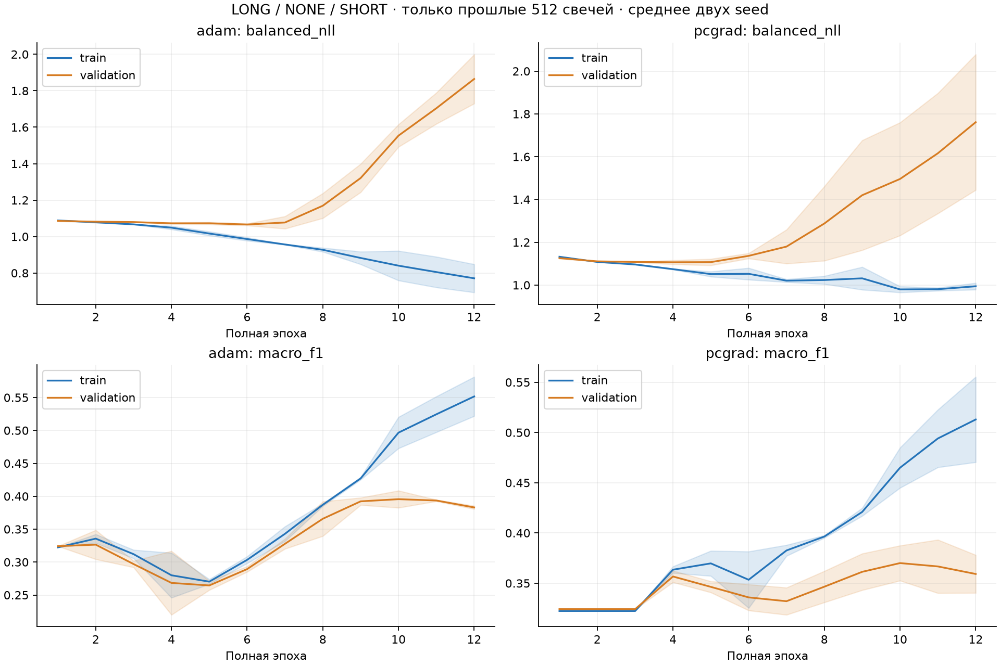
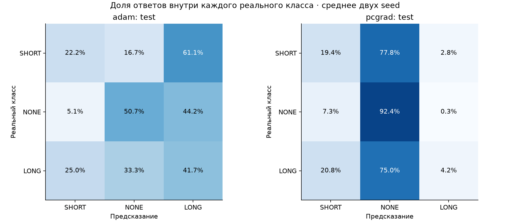

# Классификация LONG / NONE / SHORT

Первый пилот: изменение Close через 8 минут относительно текущего Close. LONG строго больше +$2, SHORT строго меньше −$2, иначе NONE. Границы ±$2 включены в NONE.
Во входе только предыдущие 512 свечей. TCN: исходная ширина 128 и пять блоков; голова заменена на три класса. Правый контекст и восстановление отсутствуют.
Всего параметров: 605,315. Четыре обучения, по 12 полных эпох на январе 2024 (27 716 окон). Validation 1–7 февраля, test 8–14 февраля. GPU worker: 2.6 мин.

Test: SHORT / NONE / LONG = [18, 660, 12]. Всегда NONE даёт 95.65% accuracy и 33.33% balanced accuracy.

## Вывод по пилоту

Средняя полнота по трём классам (balanced accuracy): Adam 38.19%, PCGrad 38.68%, всегда NONE 33.33%. Интервалы дневного bootstrap для обоих превышений над NONE включают ноль; устойчивое преимущество на этом маленьком test не установлено.
При равном весе классов модель выдаёт много ложных направленных сигналов. После поправки на естественные частоты классов обе версии отвечают только NONE. Высокая accuracy такого ответа не означает решения поставленной задачи.
По validation NLL выбраны эпохи 7/6 для Adam и 5/3 для PCGrad. Macro F1 на validation достигает более высоких значений позднее, поэтому результат зависит и от заранее выбранного критерия остановки. Последние checkpoints и их test-метрики также сохранены; по test модель не перевыбиралась.

## Результаты на test

| Метод | Правило ответа | Лучшие эпохи | Accuracy | Balanced accuracy | Macro F1 | SHORT precision / recall | LONG precision / recall |
|---|---|---|---:|---:|---:|---|---|
| adam | balanced | [7, 6] | 49.78% | 38.19% | 0.2797 | 10.59% / 22.22% | 1.61% / 41.67% |
| pcgrad | balanced | [5, 3] | 88.99% | 38.68% | 0.3510 | 3.24% / 19.44% | 8.33% / 4.17% |
| adam | natural | [7, 6] | 95.65% | 33.33% | 0.3259 | 0.00% / 0.00% | 0.00% / 0.00% |
| pcgrad | natural | [5, 3] | 95.65% | 33.33% | 0.3259 | 0.00% / 0.00% | 0.00% / 0.00% |

Среднее двух seed; checkpoint выбирается только по class-averaged validation NLL.
balanced — argmax сырых logits после обучения с равными суммарными весами классов; natural — поправка logits на частоты классов train. Правила зафиксированы до test. Это не гарантия калиброванных вероятностей.

## Проверки и ограничения

Доля классов train: [0.03427623033626786, 0.9361740510896234, 0.02954971857410882]; веса cross-entropy: [9.724912643432617, 0.35605913400650024, 11.280423164367676].
Подтверждены точные границы в центах, неизменность входов при изменении будущих цен, равенство начальных весов в паре, полное покрытие эпох. Матрицы ошибок, accuracy, balanced accuracy и macro F1 независимо пересчитаны из сохранённых logits.
Контроль утечки включает перерасчёт волатильности только по прошлым свечам. Старые масштабы, использовавшие правый контекст, не применяются.
В test всего 30 движений за порогом и шесть дат. Дневной bootstrap сохранён в bootstrap.json; малый объём и предыдущие исследования на этих датах ограничивают силу выводов.
Этот результат не доказывает отсутствие информации в M1. Он проверяет конкретный восьмиминутный таргет, входы, модель и режим обучения.

remote/ содержит checkpoints, состояния Adam, кривые и per-example logits. summary.json — полные метрики, bootstrap.json — интервалы по датам.
