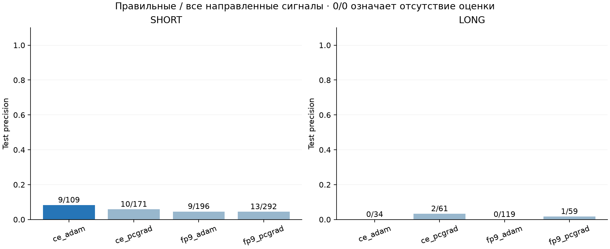
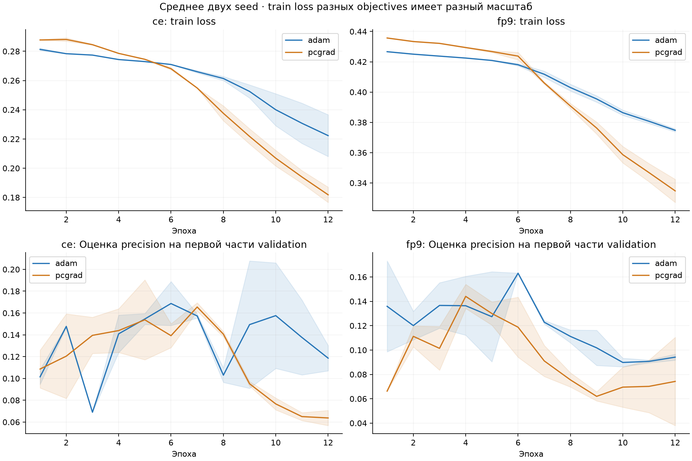
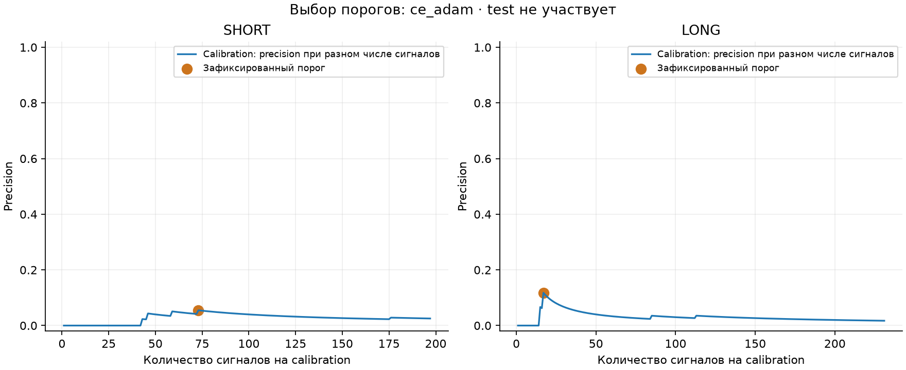

# Обучение с приоритетом precision

Таргет подтверждён пользователем: Close через 8 минут минус текущий Close; LONG >+$2, SHORT <−$2, остальные NONE. Только прошлые 512 свечей, TCN 605 315 параметров, январь train.
Выполнено 8 обучений по 12 полных эпох. GPU worker: 5.5 мин. Два seed в каждом сочетании loss и оптимизатора; итог каждого сочетания — среднее scores двух моделей.

## Что изменено

Убраны прежние обратные частотам веса классов. Контроль ce — обычная cross-entropy. fp9 добавляет штраф 9 × −log(1−p) за каждый ложный SHORT/LONG. Это дополнительный штраф, а не обещание определённого precision.
Лучшая эпоха выбирается по precision на первых 265 окнах validation. На следующих 428 окнах выбираются отдельные пороги SHORT/LONG; нужно хотя бы 5 сигналов на двух датах. Если оценка не проходит порог, ответ NONE.
Максимизируется нижняя оценка Wilson для precision, усреднённая по двум направлениям. Это защита от выбора единственного случайного попадания; после перебора и при зависимых данных она не является гарантированным доверительным пределом.

**По validation заранее выбран вариант `ce_adam`.** Все таблицы test рассчитаны после фиксации модели и порогов.
Высокого precision добиться не удалось. У выбранной модели на test SHORT: 9 правильных из 109 сигналов (8.3%); LONG: 0 из 34 (0%). В сумме 9 из 143 (6.3%). Усиленный штраф fp9 не улучшил этот результат.
Дополнительно перебраны допустимые пороги только на calibration: у выбранной модели максимальный сырой precision равен 5.5% для SHORT и 11.8% для LONG. Эти пороги совпали с выбранными. Более высокий precision не был скрыт нашим критерием Wilson при заданном минимуме 5 сигналов на двух датах.

## Результаты: только направленные сигналы

| Вариант | Precision calibration | Сигналов calibration | Precision test | Правильно / все test | Recall test |
|---|---:|---:|---:|---:|---:|
| ce_adam **выбран** | 6.7% | 90 | 6.3% | 9 / 143 | 30.0% |
| ce_pcgrad | 3.7% | 163 | 5.2% | 12 / 232 | 40.0% |
| fp9_adam | 3.9% | 206 | 2.9% | 9 / 315 | 30.0% |
| fp9_pcgrad | 3.0% | 236 | 4.0% | 14 / 351 | 46.7% |

| Вариант | Направление | Правильно | Ложные | Precision | Recall |
|---|---|---:|---:|---:|---:|
| ce_adam | SHORT | 9 | 100 | 8.3% | 50.0% |
| ce_adam | LONG | 0 | 34 | 0.0% | 0.0% |
| ce_pcgrad | SHORT | 10 | 161 | 5.8% | 55.6% |
| ce_pcgrad | LONG | 2 | 59 | 3.3% | 16.7% |
| fp9_adam | SHORT | 9 | 187 | 4.6% | 50.0% |
| fp9_adam | LONG | 0 | 119 | 0.0% | 0.0% |
| fp9_pcgrad | SHORT | 13 | 279 | 4.5% | 72.2% |
| fp9_pcgrad | LONG | 1 | 58 | 1.7% | 8.3% |

Нулевая выдача означает неопределённый precision, а не 100%. Нельзя выбирать другой вариант по этой таблице test и считать его независимым результатом.
В calibration только 7 SHORT и 7 LONG. В test 690 окон, 18 SHORT и 12 LONG, шесть дат. При нескольких сигналах проценты сильно нестабильны; количество правильных и ложных сигналов важнее красивой округлённой цифры.
Test уже использовался в предыдущих исследованиях. Это пилот на конкретном месяце; он не доказывает отсутствие информации в M1.

## Проверки

Проверки градиентов и правил: `{"ties_handled": true, "abstention_precision_is_undefined": true, "validation_support_checked": true, "wrong_short_gradient_ce": 0.7869860421615984, "wrong_short_gradient_fp9": 7.02556109926943, "group_gradient_error": 0.0, "explicit_reference_max_error": 6.661338147750939e-16, "exactly_opposing_gradients_remain_unsolved": true}`.
Проверены хэши данных и кода, одинаковая инициализация, 12 полных эпох, выбор эпох и порогов без test. Все TP/FP, precision и recall пересчитаны по сохранённым predictions и labels. Веса и per-example scores сохранены.

