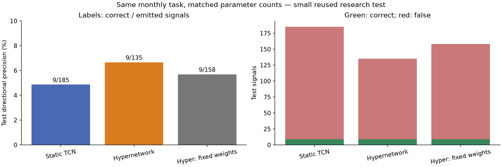
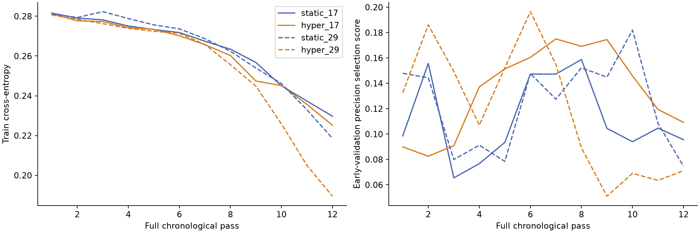

# Hypernetwork: monthly precision experiment

Validation-selected family: **static**. GPU: NVIDIA RTX PRO 6000 Blackwell Server Edition; training/evaluation worker 2.67 minutes.

Same 512-past-bar inputs; Close after eight M1 bars, >+$2 LONG, <−$2 SHORT, otherwise NONE. January 2024 train: 27,716 windows. Two seeds per architecture, 12 full chronological passes each. Ordinary CE + Adam. Both models have about 635k parameters; difference 191 parameters (0.03%).

Hypernetwork generates a rank-four correction W(c)=W0+A(c)B(c)/2 to one classifier layer. The control has a slightly wider static head and the identical initial TCN trunk within each seed. Fixed-weight ablation uses the mean TRAIN context only for weight generation; its classifier input remains real. It has its own validation-fitted thresholds and is not eligible for family selection.

Early validation selects epochs; later validation selects thresholds and the model family. Signals require a per-direction cutoff selected by Wilson lower score, at least five validation signals across two dates. No test threshold tuning. Two seed probabilities are averaged.

| Model | Calibration correct/signals | Test correct/signals | Test precision | Directional recall |
|---|---:|---:|---:|---:|
| Static TCN | 6/114 | 9/185 | 4.86% | 30.00% |
| Hypernetwork | 5/76 | 9/135 | 6.67% | 30.00% |
| Hyper: fixed weights | 5/81 | 9/158 | 5.70% | 30.00% |

| Model | SHORT correct/signals | SHORT precision | LONG correct/signals | LONG precision |
|---|---:|---:|---:|---:|
| Static TCN | 9/148 | 6.08% | 0/37 | 0.00% |
| Hypernetwork | 8/89 | 8.99% | 1/46 | 2.17% |
| Hyper: fixed weights | 8/94 | 8.51% | 1/64 | 1.56% |

Gradient probe: 24 fixed TRAIN examples, eight per class. This is a descriptive probe, not an estimate for all training data. Lower conflict fraction alone does not imply better precision.

| Trial | Selected epoch | Gradient conflict: initial → selected | Cross-class conflict: initial → selected | Dynamic variation / base weight norm |
|---|---:|---:|---:|---:|
| static_17 | 8 | 46.38% → 46.74% | 66.67% → 56.77% | — |
| hyper_17 | 7 | 46.38% → 46.38% | 66.67% → 57.29% | 0.091 |
| static_29 | 10 | 46.38% → 48.55% | 66.67% → 63.54% | — |
| hyper_29 | 6 | 46.38% → 47.83% | 66.67% → 59.90% | 0.207 |

Interpretation: on this test, static produced 9 correct and 176 false signals; dynamic weights produced 9 correct and 126 false signals. Freezing the conditioning context produced 9 correct and 149 false signals. The dynamic version has numerically higher test precision here, but the predeclared validation selection chose static. This does not establish a robust advantage. The small gradient probe still has substantial conflicts in both architectures; conditional weights did not eliminate them.

Checks passed: explicit dynamic-matrix equivalence, nonzero generator gradients, context-dependent logits, paired initial trunk hashes, all 48 full epochs, independently recomputed targets/thresholds/metrics. See verification.json and remote/run.json.

Limits: only 690 test windows, 30 directional labels, six dates; overlapping market observations and reused test period. The Wilson score is a selection heuristic, not a confidence guarantee after threshold search. Two seeds and one month cannot establish superiority or absence of information in M1. Hypernetworks still share generator parameters and do not guarantee that each example improves monotonically.
