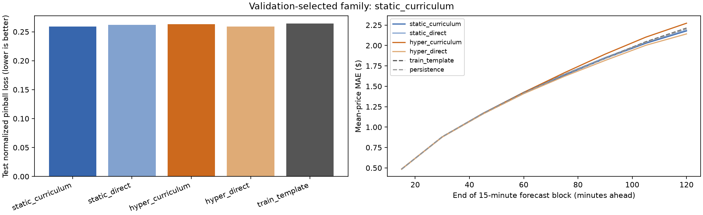
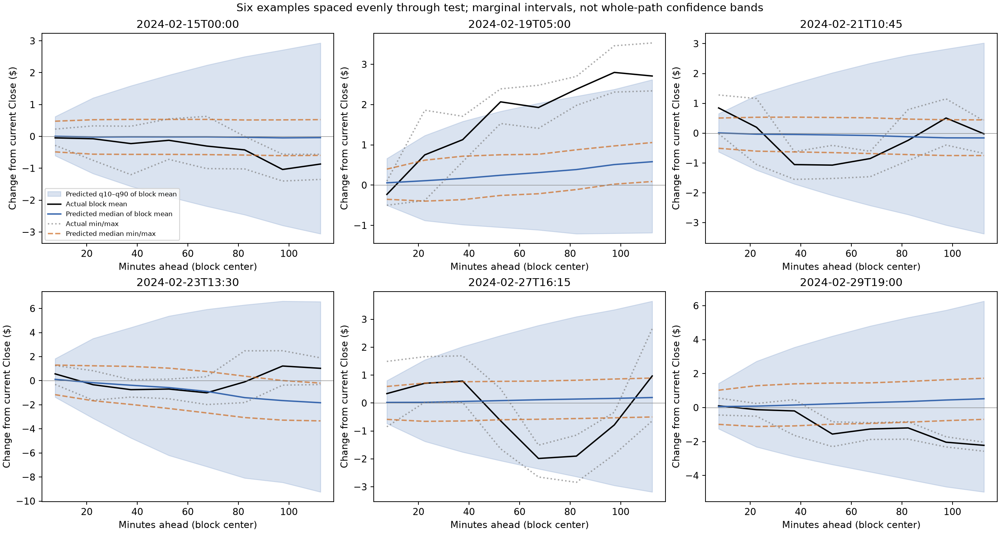
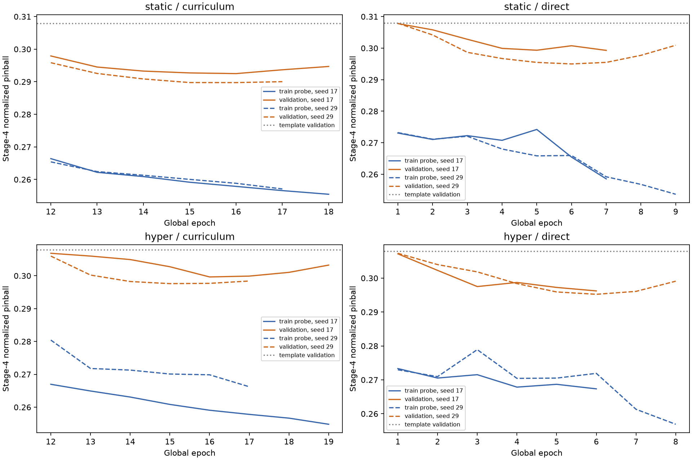

# Многомасштабная TCN: curriculum и гиперсеть

По validation выбрана **static_curriculum**. Обучение/оценка скриптом: 4.6 мин. GPU: NVIDIA RTX PRO 6000 Blackwell Server Edition.

Цель: восемь последовательных 15-минутных блоков на 120 минут вперёд. Для каждого: среднее M1 Close, минимум Low, максимум High; квантили 10%, 50%, 90%. Центральный ответ — условная медиана соответствующей статистики. Это прогноз общей картины, а не точных M1-свечей.

Контекст: 6 часов M1, 2 суток M5, 2 недели H1. Завершённые временные интервалы, пропуски помечены. Три независимые TCN-ветки по шесть остаточных блоков, dropout 25%. Гиперсеть генерирует поправку ранга 4 к одному слою. Размеры: {'static': 587499, 'hyper': 587452}.

Train: 26045 окон января, полный хронологический проход за эпоху. Validation: 397 окон 1–7 февраля. Test: 856 окон 15–29 февраля. Цели не пересекают границы периодов. Validation/test с шагом 15 минут; пересекающиеся горизонты зависимы.

Curriculum: описание прошлого → активность будущих 60/120 минут → четыре 30-минутные средние цены → восемь 15-минутных блоков. Direct: только последняя задача. Две инициализации на вариант; прогнозы усреднены. Direct имеет тот же верхний бюджет эпох, что фактически использовал парный curriculum, но может закончить раньше из-за плато. Перенос лучших промежуточных весов также является частью curriculum; это не изолированный тест только порядка задач.

| Вариант | Validation pinball | Test pinball | MAE средней цены, $ | Покрытие 80% интервала средней цены | Ширина интервала, $ |
|---|---:|---:|---:|---:|---:|
| static_curriculum | 0.2906 | 0.2591 | 1.453 | 81.2% | 5.020 |
| static_direct | 0.2957 | 0.2617 | 1.461 | 82.9% | 5.176 |
| hyper_curriculum | 0.2976 | 0.2633 | 1.487 | 83.1% | 5.273 |
| hyper_curriculum_fixed | 0.2983 | 0.2581 | 1.450 | 83.3% | 4.942 |
| hyper_direct | 0.2944 | 0.2592 | 1.440 | 79.1% | 4.817 |
| hyper_direct_fixed | 0.2944 | 0.2591 | 1.439 | 79.1% | 4.811 |
| train_template | 0.3079 | 0.2641 | 1.463 | 83.7% | 5.145 |

Прогноз «цена останется текущей»: MAE средней цены **$1.460**. train_template — квантили будущих нормированных траекторий, вычисленные только на TRAIN и масштабированные доступной прошлой волатильностью. Он учитывает типичный размах и служит более сильной вероятностной базой, чем нулевая линия.

Гиперсеть *_fixed: выбранные веса сохранены; условие генератора заменено средним TRAIN-контекстом. Это диагностическая проверка без переобучения, исключённая из выбора семейства.

| Запуск | Эпохи по этапам | Выбранная финальная эпоха |
|---|---|---:|
| static_curriculum_17 | 1: 3 (cap), 2: 4 (cap), 3: 4 (cap), 4: 7 (plateau) | 16 |
| static_direct_17 | 4: 7 (plateau) | 7 |
| hyper_curriculum_17 | 1: 3 (cap), 2: 4 (cap), 3: 4 (cap), 4: 8 (plateau) | 16 |
| hyper_direct_17 | 4: 6 (plateau) | 6 |
| static_curriculum_29 | 1: 3 (cap), 2: 4 (cap), 3: 4 (cap), 4: 6 (plateau) | 16 |
| static_direct_29 | 4: 9 (plateau) | 6 |
| hyper_curriculum_29 | 1: 3 (cap), 2: 4 (cap), 3: 4 (cap), 4: 6 (plateau) | 15 |
| hyper_direct_29 | 4: 8 (plateau) | 6 |

| Этап | Константный TRAIN-шаблон: validation loss | Static curriculum: средний лучший loss двух запусков | Hyper curriculum: средний лучший loss двух запусков |
|---|---:|---:|---:|
| 1 | 0.4154 | 0.1100 | 0.1181 |
| 2 | 0.7302 | 0.6423 | 0.6374 |
| 3 | 0.2985 | 0.2867 | 0.2925 |
| 4 | 0.3079 | 0.2911 | 0.2986 |

Значения loss разных этапов напрямую несопоставимы. Эта таблица показывает качество относительно собственного простого шаблона каждого этапа на validation, использованном для выбора весов. Пользу curriculum для конечной задачи оцениваем по test-сравнению с direct.

Разница MAE, $: отрицательное значение означает преимущество первого варианта. Интервалы получены парным bootstrap по целым календарным дням; при небольшом числе дней это ориентир, не доказательство переносимости.

| Сравнение | Разница | 95% интервал по дням |
|---|---:|---:|
| static_curriculum_vs_template | -0.010 | [-0.043; 0.025] |
| static_curriculum_vs_persistence | -0.007 | [-0.041; 0.028] |
| static_curriculum_minus_direct | -0.008 | [-0.031; 0.013] |
| hyper_curriculum_minus_direct | 0.047 | [-0.005; 0.102] |

Разница нормированного pinball loss выбранной модели и исторического шаблона: -0.00500; 95% интервал по дням [-0.01291; 0.00166]. Интервал также включает ноль.

Вывод: описание видимого прошлого освоено заметно лучше константного шаблона; прогноз активности на validation улучшился умеренно. Для будущей центральной траектории выигрыш на test очень мал и не подтверждён проверкой по дням. Поэтапная обычная TCN выбрана на validation, но устойчивое преимущество curriculum и гиперсети не установлено. На равномерно выбранных графиках центральный прогноз чаще остаётся близко к текущей цене со слабым наклоном, тогда как диапазон расширяется. Покрытие интервала около 80% само по себе не означает, что модель угадывает изгибы цены.

Проверены исходные цели и доступность агрегатов (data_verification.json), полные проходы данных, исходные веса общих TCN-веток, выбранные эпохи, порядок квантилей и диапазонов, независимый пересчёт метрик и baseline (verification.json).

Ограничения: один месяц обучения; один будущий тестовый период; подбор эпох и архитектуры на небольшой validation-выборке. Интервалы маргинальные: они не являются 80%-гарантией всей траектории. Среднее квантилей двух моделей — ансамблевый прогноз, а не точные квантили смеси распределений. Даже успех задачи описания прошлого не доказывает предсказуемость будущего. Результаты не позволяют заключить, что в M1 отсутствует информация.
