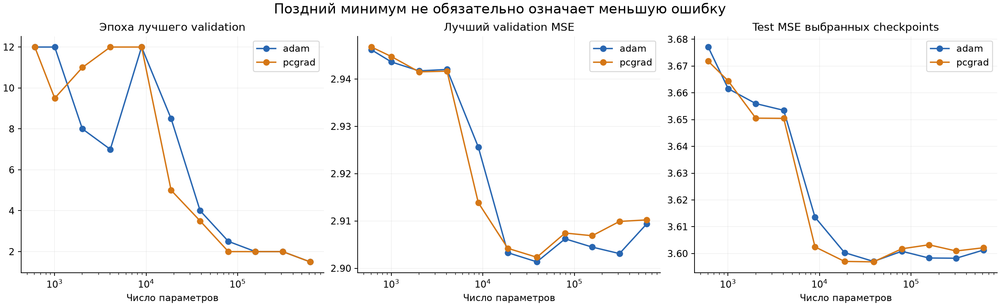
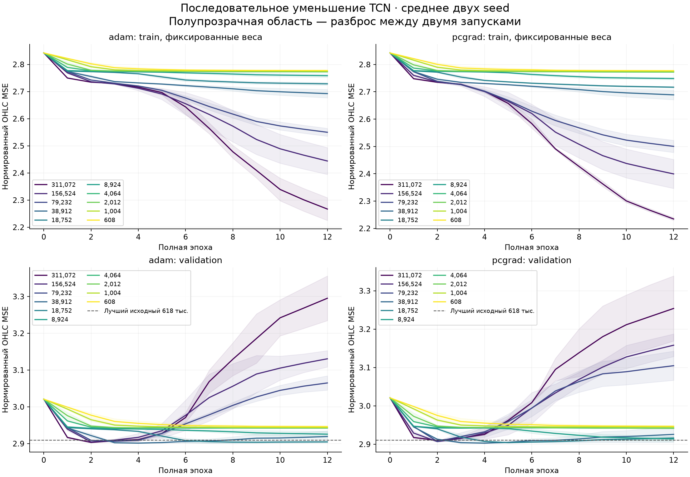
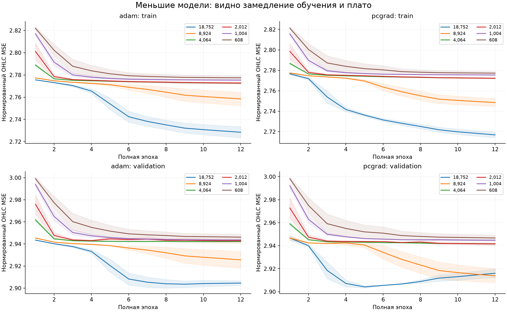
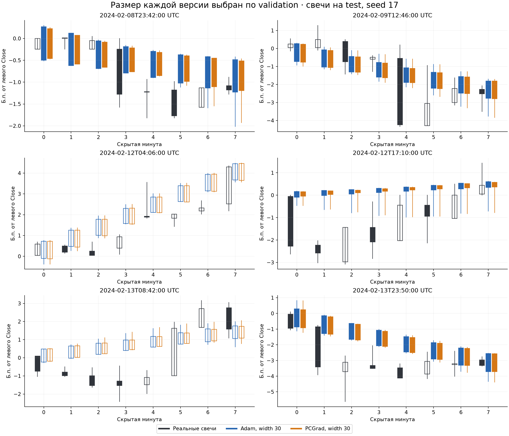

# Последовательное уменьшение TCN

Проверено уменьшенных размеров: 10; обучений: 40. Время worker: 31.7 мин.

Месяц train — январь 2024, 27 716 окон за эпоху. 1–7 февраля validation, 8–14 февраля test. Контекст 512 слева и справа; восстанавливаем восемь минут.
Две версии: MSE + Adam и MSE + Adam + групповой PCGrad. Два seed, по 12 полных эпох, одинаковый порядок данных и LR. Меняется только ширина encoder/decoder; глубина, рецептивное поле и отображение в OHLC сохраняются.
Train и validation у новых моделей измерены при одних и тех же фиксированных весах после эпохи. Train online дополнительно сохранён в JSON.

## Как читать результат

Уменьшение действительно отодвинуло лучший validation: исходная сеть — эпохи 1–2, 38 912 параметров — 3–4, 18 752 — 5–9, 8 924 — последняя, двенадцатая эпоха во всех четырёх запусках. Это подтверждает изменение динамики при уменьшении размера.
На одинаковом бюджете 12 эпох лучший средний validation у обеих версий даёт размер 38 912. При 8 924 параметрах обучение ещё не достигло минимума; худший результат пока не доказывает недостаточную ёмкость. Нужен более длинный прогон, чтобы отделить медленное обучение от ограничения модели.
При 4 064 параметрах и ниже улучшение в этих 12 эпохах небольшое, качество хуже. Продолжать уменьшение этой реализации до width 1 нельзя без изменения LayerNorm.
У выбранного размера 38 912 test OHLC MSE: Adam 3.59703, PCGrad 3.59688. Выигрыш PCGrad около 0.004%; парный bootstrap по шести датам допускает оба знака разницы. Убедительного выигрыша по общей ошибке нет. Предсказания всё ещё сильно сглаживают свечи; изменение размера это не исправило.

## Результаты

| Параметров | Метод | Лучшие эпохи, два seed | Validation MSE | Test MSE | Последний train | Последний validation |
|---:|---|---|---:|---:|---:|---:|
| 617,504 | adam | [1, 2] | 2.90939 | 3.60129 | — | — |
| 617,504 | pcgrad | [1, 2] | 2.91022 | 3.60215 | — | — |
| 311,072 | adam | [2, 2] | 2.90310 | 3.59823 | 2.26705 | 3.29523 |
| 311,072 | pcgrad | [2, 2] | 2.90990 | 3.60094 | 2.23448 | 3.25383 |
| 156,524 | adam | [2, 2] | 2.90448 | 3.59832 | 2.44407 | 3.13061 |
| 156,524 | pcgrad | [2, 2] | 2.90688 | 3.60325 | 2.39938 | 3.15800 |
| 79,232 | adam | [3, 2] | 2.90622 | 3.60084 | 2.54991 | 3.06490 |
| 79,232 | pcgrad | [2, 2] | 2.90745 | 3.60176 | 2.50031 | 3.10463 |
| 38,912 | adam | [4, 4] | 2.90136 | 3.59703 | 2.69235 | 2.91926 |
| 38,912 | pcgrad | [4, 3] | 2.90233 | 3.59688 | 2.68881 | 2.92564 |
| 18,752 | adam | [9, 8] | 2.90329 | 3.60032 | 2.72846 | 2.90456 |
| 18,752 | pcgrad | [5, 5] | 2.90421 | 3.59704 | 2.71688 | 2.91604 |
| 8,924 | adam | [12, 12] | 2.92562 | 3.61355 | 2.75841 | 2.92562 |
| 8,924 | pcgrad | [12, 12] | 2.91386 | 3.60247 | 2.74852 | 2.91386 |
| 4,064 | adam | [5, 9] | 2.94203 | 3.65347 | 2.77259 | 2.94224 |
| 4,064 | pcgrad | [12, 12] | 2.94167 | 3.65046 | 2.77231 | 2.94167 |
| 2,012 | adam | [12, 4] | 2.94173 | 3.65599 | 2.77273 | 2.94288 |
| 2,012 | pcgrad | [12, 10] | 2.94152 | 3.65054 | 2.77225 | 2.94161 |
| 1,004 | adam | [12, 12] | 2.94361 | 3.66156 | 2.77532 | 2.94361 |
| 1,004 | pcgrad | [12, 7] | 2.94475 | 3.66447 | 2.77544 | 2.94481 |
| 608 | adam | [12, 12] | 2.94617 | 3.67710 | 2.77742 | 2.94617 |
| 608 | pcgrad | [12, 12] | 2.94677 | 3.67182 | 2.77727 | 2.94677 |

618 тыс. — сохранённые агрегаты предыдущего теста; исходные поминутные предсказания и кривые утрачены при сбросе среды. Его обучающий код и агрегаты восстановлены с Colab.

## Правило остановки

На каждом размере проверяется: у обеих версий средний лучший validation эпох 4–12 хотя бы на 0.2% ниже лучшего эпох 1–3; train между этими выбранными эпохами падает у обоих seed; поздний validation не хуже исходной модели более чем на 0.2%. Иначе число параметров снова уменьшается примерно вдвое.
Это правило отличает более длительное полезное обучение от простого замедления. Самый малый допустимый width 2: при width 1 LayerNorm уничтожает различия единственного канала.

Причина остановки: `user-requested remaining widths completed through minimum nondegenerate width 2`.
Лучший размер среди уменьшенных по среднему validation: Adam width30, PCGrad width30.
Первый этап остановился на 18 752 параметрах. После прямого указания пользователя продолжить заранее зафиксирован второй этап: 8 924 → 4 064 → 2 012 → 1 004 → 608 параметров, без досрочной остановки.
Внутри каждого этапа решения о размерах зафиксированы до его test. Первый test уже был вычислен до расширения эксперимента; это повторно используемая исследовательская выборка. Выбор размеров и checkpoints использует только validation. Все лучшие и последние checkpoints оценены и сохранены.

## Сравнение с интерполяцией без обучения

Линейный мост между известными границами: test OHLC MSE 3.77980, Close MSE 4.67441 б.п.².
Снижение общей ошибки OHLC само по себе не означает восстановления траектории закрытий. Close MSE и отношение вариации предсказания к реальной сохранены отдельно в summary.json.

## Проверки и ограничения

Проверки реализации: `{"explicit_reference_max_error": 6.661338147750939e-16, "exactly_opposing_gradients_remain_unsolved": true, "group_gradient_error": 5.551115123125783e-17, "width128_output_max_error": 0.0}`.
Проверены SHA данных/кода, равенство начальных весов в каждой паре, 12 полных эпох по 27 716 окон, расписание LR; test MSE независимо пересчитан из предсказаний.
Всего шесть дат test и два seed; это исследовательский пилот. Данные ранее использовались в исследовании. Снижение train и рост validation согласуются с переобучением, но не доказывают, что сеть просто запоминает примеры или что информации в данных нет.
PCGrad применяется к четырём группам по 32 примера и не исключает все конфликты. Задача использует правый контекст и не является причинным прогнозом будущего.

Артефакты: remote/ — модели, Adam state, кривые, предсказания; summary.json — все размеры; selected_comparison.json и matched_width_comparison.json — парный bootstrap по дням. Выбранные по validation размеры могут различаться; сравнение при одинаковом размере находится во втором файле. Интервалы не скорректированы за множество сравнений.
gradient_diagnostics.json показывает конфликты групп и долю групп, которым шаг мешает в линейном приближении. projected_harm_fraction — до преобразования Adam; adam_harm_fraction — после фактического изменения весов, на периодической подвыборке шагов. Эти величины не гарантируют знак фактического изменения loss после конечного шага.
Для обычного Adam projected_harm_fraction вычисляется для сравнения, но проекция не применяется к обновлению весов.

Воспроизведение на CUDA: `python experiments/pcgrad_capacity/reproduce.py --data reports/pcgrad_mse_month_20261009/dataset.npz --out /path/to/new-output`. Требуются PyTorch с CUDA и NumPy; matplotlib нужен только для отчёта.
