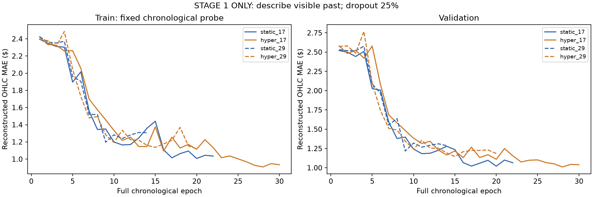
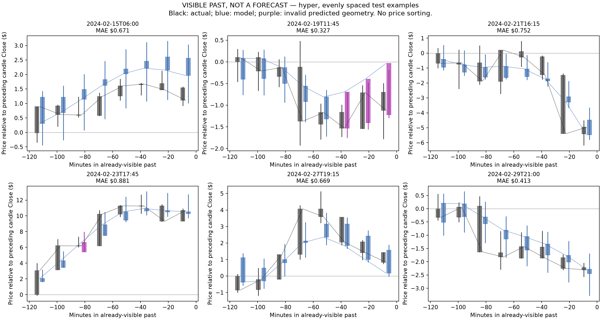
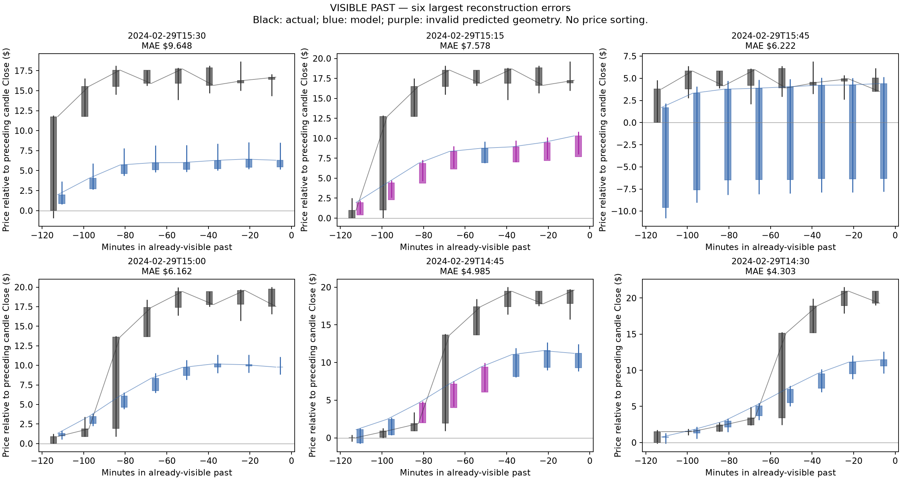
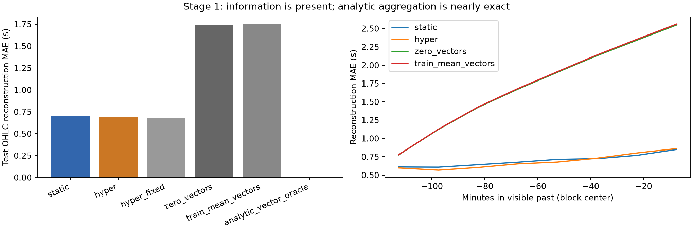

# Transformer — только первый этап

На validation выбран **hyper**. Выполнено четыре запуска первого этапа: две архитектуры × две инициализации. Обучение/оценка скриптом: 1.97 мин. Следующие этапы не запускались.

Задача: из угловых векторов видимой истории описать последние 120 минут восемью 15-минутными свечами. Последние четыре свечи описывают последние 60 минут. Это прошлое, полностью присутствующее во входе. Результат не является прогнозом будущего.

Представление: H/O/C/L приращения лог-цен → (2/π) atan(delta/scale). Лаги 1,2,3,5,8,13,21,34,55. Масштабы определены только на TRAIN. В модель входят лишь векторы и признаки доступности; абсолютные цены, привязка к текущему Close, уровни волатильности и таргеты отсутствуют. Векторные суммы до atan восстанавливают путь; max/min сохраняют экстремумы укрупнённых свечей.

Контекст: 360 M1, 576 M5, 336 H1 завершённых свечей. Transformer: четыре слоя, четыре attention heads, ширина96, feedforward192, dropout25%. Восемь learned summary queries. Encoder видит только прошлое, без teacher forcing. Параметры: {'static': 413439, 'hyper': 413396}. Общие encoder-веса совпадают при старте парных моделей.

Train: 19396 окон января; каждый проход хронологический и полный. Validation: 305 окон 1–7 февраля. Test: 642 окон 15–29 февраля. Это исследовательские, ранее встречавшиеся рыночные периоды, не независимый финальный торговый тест.

Loss: Huber по накопленным декодированным перемещениям + 0,1 MSE угловых векторов. Абсолютные цены в loss не нужны. В правильном таргете loss и выходной градиент точно равны нулю. Проверены градиенты всех encoder-слоёв, генератора весов, dropout и детерминированный eval. Весь путь декодируется из предсказанных векторов, без подстановки правильных промежуточных свечей.

| Вариант | Test OHLC MAE, $ | Close MAE, $ | Последние 60 мин OHLC MAE, $ | Верных по геометрии свечей | Угловая MAE |
|---|---:|---:|---:|---:|---:|
| static | 0.6990 | 0.7310 | 0.7642 | 89.2% | 26.24° |
| hyper | 0.6865 | 0.7194 | 0.7678 | 84.2% | 25.43° |
| hyper_fixed | 0.6829 | 0.7165 | 0.7568 | 85.7% | 25.47° |
| zero_vectors | 1.7410 | 1.7774 | 2.2322 | 100.0% | 36.50° |
| train_mean_vectors | 1.7481 | 1.7832 | 2.2424 | 65.7% | 36.54° |
| repeat_previous_vector | 3.9890 | 4.3225 | 5.6223 | 10.2% | 47.45° |
| analytic_vector_oracle | 0.0000 | 0.0000 | 0.0000 | 95.0% | 0.00° |

Геометрия в таблице проверена строго, без допуска. У аналитического oracle нарушения на границах связаны с округлением float32-векторов: при допуске половины цента валидны 100.0% свечей. Для моделей приведены исходные нарушения, без исправления OHLC.

Выбранная модель уменьшила ошибку относительно нулевых векторов на 60.6%. Нулевые векторы повторяют предшествующую крупную свечу. TRAIN mean vectors — средние векторы TRAIN, repeat_previous_vector — повтор последнего крупного перемещения. Аналитический oracle строит целевые векторы только из входных M1-векторов, в произвольной нулевой системе координат; абсолютная привязка нужна лишь для итогового отображения в долларах.

hyper_fixed — выбранная гиперсеть с условием генерации весов, заменённым средним TRAIN-контекстом каждого запроса. Это диагностическая проверка без переобучения, исключённая из выбора модели. Предсказанные OHLC не сортируются и не исправляются; ошибки геометрии сохраняются и отмечаются пурпурным.

[Интерактивный просмотр всех 642 примеров](review.html) — выбор модели, окна, среднего и худшего по ошибке примера.

| Запуск | Эпохи | Выбранная эпоха | Причина остановки |
|---|---:|---:|---|
| static_17 | 22 | 20 | plateau |
| hyper_17 | 30 | 28 | cap |
| static_29 | 14 | 9 | plateau |
| hyper_29 | 20 | 15 | plateau |

Разница средних ошибок по календарным дням; отрицательная означает меньшую ошибку первого варианта. 95% интервалы — описательный парный bootstrap по дням, не по зависимым окнам.

| Сравнение | Разница, $ | 95% интервал |
|---|---:|---:|
| hyper_minus_zero_vectors | -1.0544 | [-1.2773; -0.8644] |
| hyper_minus_train_mean_vectors | -1.0616 | [-1.2845; -0.8694] |
| hyper_minus_static | -0.0125 | [-0.0313; 0.0116] |

Оценка первого этапа: модели научились воспроизводить крупное движение видимого прошлого и существенно превосходят постоянные векторные ответы. Детали тел и экстремумов ещё неточны; выбранная гиперсеть допускает около 15.8% геометрически неверных свечей. Точное освоение агрегации пока не достигнуто. Разница между архитектурами мала; её парный интервал приведён выше.

Отдельный факт: данные достаточны для этого первого этапа, потому что точный алгоритм восстанавливает ответ из входных векторов почти без ошибки. Остаточная ошибка модели отражает изучение агрегации, архитектуру, оптимизацию и выбранный бюджет. Она не свидетельствует о нехватке будущей информации: будущего в задаче вообще нет.

Готово для оценки пользователем. Автоматического перехода к этапу2 нет. Веса, прогнозы, исходные хэши и проверки сохранены. См. protocol.md, data_verification.json и verification.json.
