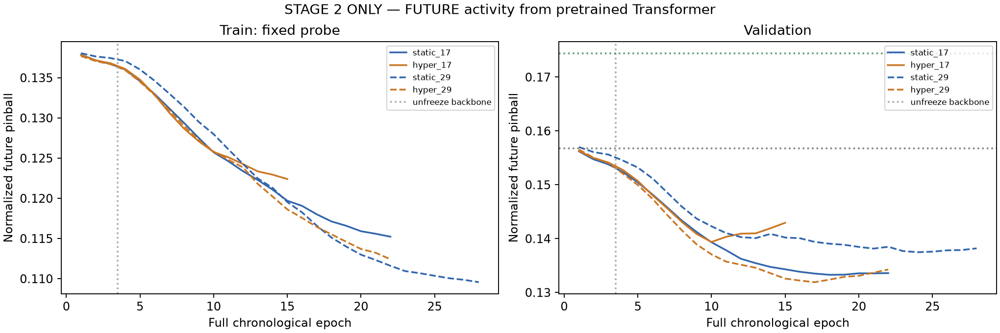
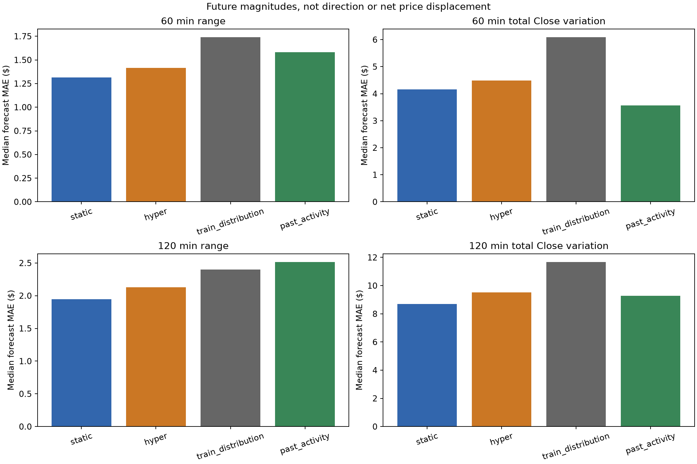
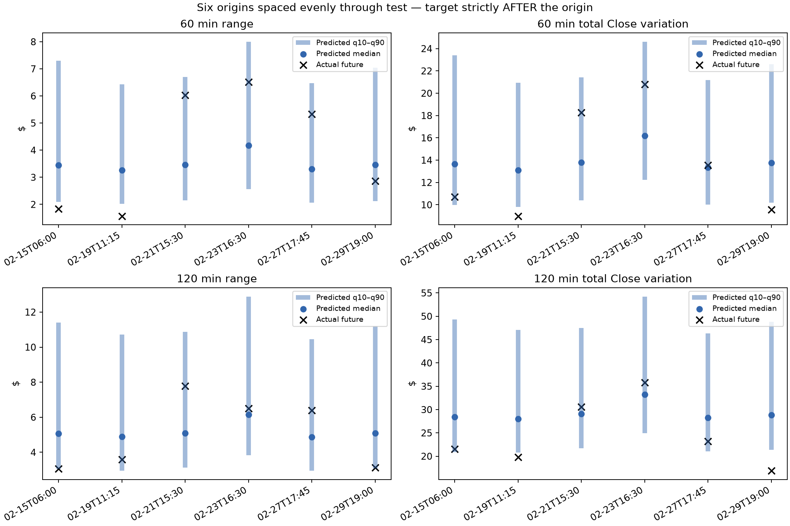
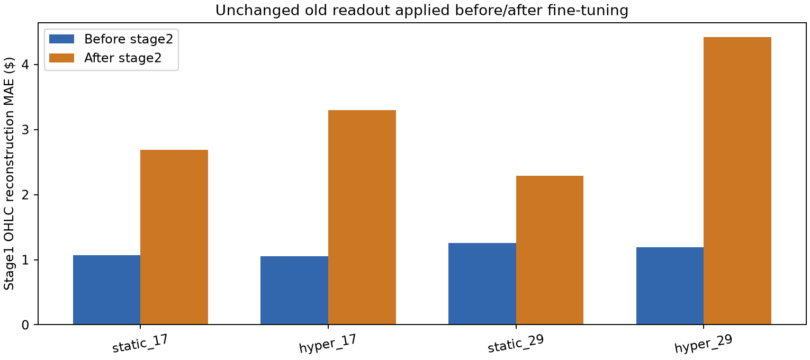

# Transformer — только этап 2: будущая активность

Выбрана по validation модель **static**, простой ориентир **train_distribution**. Обучение/оценка скриптом: 1.61 мин. Первый этап не продлевался; третий не запускался.

Цели действительно будущие: диапазон max High−min Low и сумма абсолютных минутных изменений Close на следующих 60 и 120 минутах. Сумма колебаний — длина пути, не направленное изменение цены. Модель не выдаёт LONG/SHORT или будущие свечи. Квантили10/50/90 описывают маргинальную неопределённость величин.

Входы побитово совпадают с этапом1: угловые H/O/C/L-векторы и доступность данных. Абсолютные уровни, новые признаки волатильности и будущие свечи во входе отсутствуют. Цели относительны к доступному текущему Close и нормированы фиксированными медианами TRAIN. Доллары рассчитываются после модели для отчёта.

Train: 16756 окон января, полный хронологический проход за эпоху. Validation: 265 окон 1–7 февраля. Test: 554 окон 15–29 февраля. Все будущие120 минут реально наблюдаются без пропусков; цели не пересекают границы выборок. Рыночные периоды исследовательски использованы ранее, не новый независимый торговый тест.

Перенесены все прежние веса из best-checkpoint каждого запуска этапа1. Добавлены только выходы активности. Старый readout заморожен; первые3 эпохи заморожены все прежние веса, затем они обновляются с LR в10 раз меньше новых выходов. Dropout25%. Loss — обычный pinball для четырёх будущих величин и трёх квантилей. Оптимизатор для новой задачи сброшен, веса сохранены.

| Вариант | Validation pinball | Test pinball | MAE размаха60, $ | MAE размаха120, $ | MAE колебаний60, $ | MAE колебаний120, $ |
|---|---:|---:|---:|---:|---:|---:|
| static | 0.1320 | 0.0958 | 1.314 | 1.947 | 4.155 | 8.687 |
| hyper | 0.1321 | 0.1050 | 1.416 | 2.129 | 4.486 | 9.517 |
| hyper_fixed | 0.1369 | 0.1032 | 1.378 | 2.036 | 4.558 | 9.446 |
| train_distribution | 0.1568 | 0.1290 | 1.739 | 2.398 | 6.085 | 11.669 |
| past_activity | 0.1744 | 0.1067 | 1.581 | 2.514 | 3.559 | 9.285 |

train_distribution — безусловные квантили TRAIN. past_activity — квантили отношения будущей активности к прошлому Close-прокси, подогнанные только на TRAIN. Сам прокси восстановлен из входных Close-векторов в произвольных координатах; абсолютные цены и будущие ответы ему не нужны. Лучший baseline выбран на validation до теста. hyper_fixed — диагностическая фиксация условия гиперсети средним TRAIN-контекстом, без переобучения и без участия в выборе модели.

| Вариант | Покрытие80%: range60 / range120 | Покрытие80%: variation60 / variation120 |
|---|---:|---:|
| static | 78.3% / 79.6% | 64.4% / 59.9% |
| hyper | 77.3% / 76.5% | 65.9% / 58.3% |
| hyper_fixed | 75.8% / 78.0% | 64.4% / 57.8% |
| train_distribution | 64.3% / 67.0% | 48.2% / 49.8% |
| past_activity | 84.7% / 87.0% | 83.4% / 82.5% |

Калибровка выбранной модели: для суммы колебаний на60/120мин ниже q10 оказалось 30.0% / 34.7% ответов вместо ожидаемых10%. Это показывает смещение нижней границы вверх и завышение низкой активности, а не доказывает, что проблема только в ширине интервала. Никакая калибровка по test не применялась.

[Интерактивный просмотр всех 554 будущих прогнозов](review.html) — модели, простые ориентиры, выбор окна и худшего случая.

| Запуск | Эпохи / выбранная | MAE прежнего readout до → после, $ |
|---|---:|---:|
| static_17 | 22 / 18 | 1.068 → 2.690 |
| hyper_17 | 15 / 10 | 1.056 → 3.293 |
| static_29 | 28 / 24 | 1.260 → 2.289 |
| hyper_29 | 22 / 17 | 1.193 → 4.420 |

Ошибка первого этапа проверяется на тех же validation-окнах через прежний фиксированный выход. Его ухудшение показывает потерю совместимости с прежним декодером; оно не доказывает полное исчезновение информации из новых признаков. Loss первого этапа в обучение не добавлялся.

| Парная разница pinball: выбранная модель минус… | Средняя разница | 95% интервал по дням |
|---|---:|---:|
| static_minus_train_distribution | -0.0333 | [-0.0419; -0.0250] |
| static_minus_past_activity | -0.0109 | [-0.0217; -0.0005] |
| static_minus_hyper | -0.0093 | [-0.0156; -0.0046] |

Дополнительная описательная проверка контекста: при2000 случайных перестановках прогнозов внутри каждого календарного дня средний pinball вырос с 0.0958 до 0.1086. Правильная привязка к окну даёт 11.8% выигрыша относительно такого перемешивания. Проверка добавлена после просмотра прогнозов, не участвовала в выборе весов или семейства; перестановочный p-value не заявляется из-за зависимости перекрывающихся окон.

Оценка этапа2: на этом периоде получен полезный прогноз будущей активности. Обычный Transformer оказался лучше варианта с гиперсетью по выбранному loss. Интервалы суммарной активности плохо откалиброваны, и точность старого фиксированного выхода реконструкции заметно ухудшилась. Успех нового прогноза не означает предсказание направления или формы будущих свечей.

Разница выбранной модели относительно выбранного простого ориентира на test: 25.8% уменьшения pinball (отрицательное значение означает ухудшение). Bootstrap по целым календарным дням описательный; перекрывающиеся окна зависимы. Подбор на небольшой validation и один период не доказывают переносимость результата.

Проверки: исходные будущие цели пересчитаны, все будущие цены искусственно изменены — входы не изменились, target изменился; незавершённые H1 исключены. Проверены перенос весов, неизменность в warmup, исходные хэши, полные эпохи, метрики, baseline без будущих labels, порядок квантилей и показатели прежнего навыка. См. data_verification.json и verification.json.

Дальнейшие этапы не выполнялись. Результат подготовлен для оценки пользователем. Этот запуск не проверял, поможет ли более долгое обучение первого этапа; использованы именно уже сохранённые веса.
