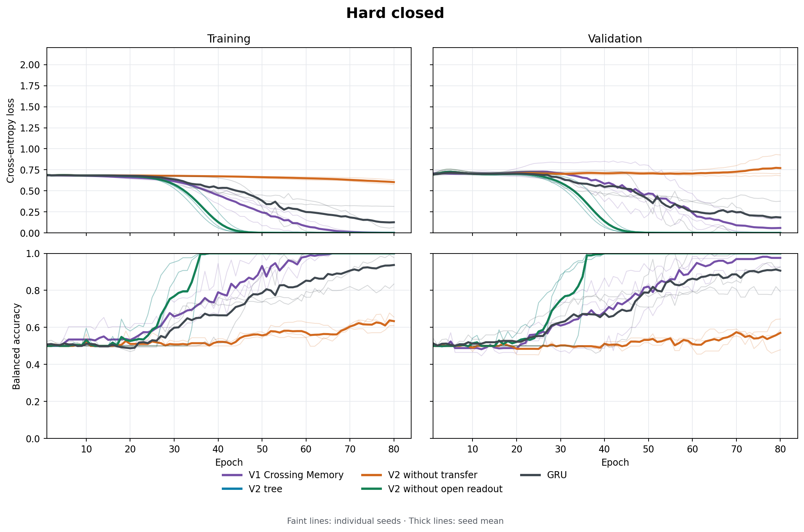
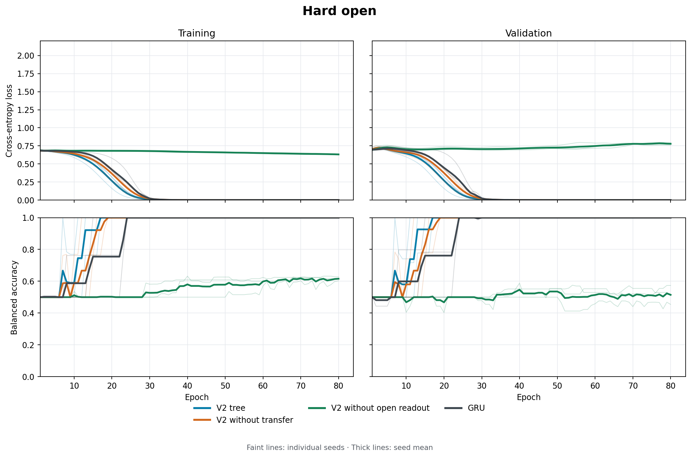

# Crossing Memory v2: mechanism acceptance report

Repository: https://github.com/Flyingzaptop/xauusd
Branch: `crossing-memory-mechanism-v2`.
Frozen training code/config: `104022f5cabe9dda532380604a6d86ea584c1080`.
V1 preserved at `b160b4e523064c6c90990c22c60a5715c6a093aa` on `crossing-memory-v1`.
The final published report SHA is supplied in the GitHub review and delivery message.

## Conclusion for acceptance

The repaired operator satisfies the defined tree/streaming/accounting invariants and learns the intended order-of-nested-history dependency in this finite synthetic family. Full v2 reached 1.000 independent-test balanced accuracy on all four supervised stages and every seed; all three models memorized the separate tiny set. Transfer content matters for completed-event retention (hard closed falls to 0.489 without it), while open readout matters before the outer event closes (hard open falls to 0.500 without it). Transfer adds no measured benefit on this particular open task. GRU also solves several tasks and scores 0.918 on hard closed under the same update/parameter budget; this is not a general superiority claim.

The untouched v1 reaches 0.992 on hard closed under the new diagnostic schedule. Thus the old failure was not label ambiguity or an intrinsic impossibility of encoding the mapping. Its exact optimization/generalization cause is not isolated by the changed-budget comparison. Structural defects in v1 were independently demonstrated and repaired; synthetic improvement alone cannot be attributed exclusively to those repairs. No market benefit or profitability is established.

## Scope and invariant evidence

No market training was run and no market dataset was used by the v2 runner. January–August 2026 remains exposed. V1 source, market protocol and negative results are preserved unchanged.

The pre-implementation tree specification and manual traces were published in `f2bc339f47b0d7d2022d880168982823f25ed954`. V2 uses a permanent root and immutable event/parent IDs, with genuinely contained lifetimes. Every child closes into its recorded live parent once. An ancestor return forces unfinished descendants to finalize deepest-first at the observed endpoint, explicitly labelled as forced finalization. A jump produces one raw observation and at most one birth. It never invents intraminute prices. Symmetric amplitude comparisons replace floor grids; tolerance scales with the smallest threshold.

Only the deepest live node consumes a raw observation. Completed child state is merged into its parent through a learned GRU. Root consumes raw input only outside a coarse event, avoiding an unrestricted raw-sequence bypass around the tree. Open state and completed state have defined places in the active chain/root. Operational state has at most four nodes and four hidden vectors; an optional unbounded debugging ledger is disabled by default.

All 37 pretraining tests passed: temporal containment and unique ownership, mirrored random trajectories, jumps and simultaneous/forced closures, bounded state, full/step/chunk outputs, serialization resume, full/chunk gradients, causality, finite gradients, oracle labels, disjoint generated samples and matched model sizes. Exact additive-cell instrumentation verifies that the sum of live states contains each distinct raw payload exactly once at every step, with derivative one for every payload. See `docs/mechanism-v2-invariants.md` for the induction argument and its limits. Bounded learned vectors can forget content: message accounting is not an information-theoretic losslessness claim.

## Independent investigation of the v1 failure

An independent parser of observed log-close increments decoded all 1440 original examples and another 4000 sampled paths. Exhaustive enumeration covered 1,081,344 original closed-path derivations with zero opposite-label collisions. Thus ambiguity or a missing observable target does not explain v1's old near-chance result. The original open-prefix construction also exposed the label via its final increment; the v2 open cut was moved three *existing* outer-return observations later before fitting. Exhaustive terminal-feature balancing covered 327,696 observable prefixes. Neither target order nor the original closed hard generator was changed to favor Crossing Memory.

V1 reruns below are new diagnostics, not replacements for its published negative experiment. Their examples, input normalization and update count differ from the old 320-example/10-epoch run. Consequently success here rules out an inherent inability to encode this mapping, but does not isolate a single cause of the old optimizer/generalization failure. It would be incorrect to claim that the routing repair alone caused all improvement, especially if the untouched v1 or GRU also learns.

## Frozen training schedule and complete results

54 completed fits, seeds 7/19/43, one fixed configuration. Tiny memorization: 16 examples, 300 updates. Other tasks: 128 train, 64 validation, 128 test paths, 80 updates, all paths disjoint across splits. Every fit starts from scratch. Easy uses one outer excursion, medium adds an earlier distractor, hard retains the original noisy two-excursion grammar. Open ends at ±4 during the outer return; no end-of-input flush is applied. Random labels are independent of paths in each split.

Tree and GRU have 14,370 and 14,358 parameters (difference 0.084%). Update/data/optimizer budgets are matched. V1 has 8,630 parameters and is a smaller diagnostic comparator. Ablations retain nominal parameter tensors even when a disabled path receives no useful gradient. All computed gradients remained finite; per-parameter actual changes are recorded. The 54 fits record 2325.2 aggregate training seconds, including concurrent CPU contention; these are not isolated speed measurements. Scheduling overlapped independent tasks, with no cross-task model state or selection.

Balanced accuracy; columns list every seed in order 7/19/43. Tiny rows show **training memorization**, not independent test performance. All other rows use the validation-selected checkpoint's independent test. Raw JSON retains every epoch's train/validation loss and balanced accuracy; CSV exports retain both final and selected checkpoint results per fit.

| Task | Variant | Seeds 7 / 19 / 43 | Mean ± SD | Final train mean | Parameters |
|---|---|---:|---:|---:|---:|
| tiny_hard | v1 | 1.000 / 1.000 / 1.000 | 1.000 ± 0.000 | 1.000 | 8630 |
| tiny_hard | tree | 1.000 / 1.000 / 1.000 | 1.000 ± 0.000 | 1.000 | 14370 |
| tiny_hard | gru | 1.000 / 1.000 / 1.000 | 1.000 ± 0.000 | 1.000 | 14358 |
| easy_closed | tree | 1.000 / 1.000 / 1.000 | 1.000 ± 0.000 | 1.000 | 14370 |
| easy_closed | gru | 1.000 / 1.000 / 1.000 | 1.000 ± 0.000 | 0.979 | 14358 |
| medium_closed | tree | 1.000 / 1.000 / 1.000 | 1.000 ± 0.000 | 1.000 | 14370 |
| medium_closed | gru | 1.000 / 0.992 / 0.992 | 0.995 ± 0.005 | 1.000 | 14358 |
| hard_closed | v1 | 1.000 / 1.000 / 0.977 | 0.992 ± 0.014 | 1.000 | 8630 |
| hard_closed | tree | 1.000 / 1.000 / 1.000 | 1.000 ± 0.000 | 1.000 | 14370 |
| hard_closed | no_transfer | 0.506 / 0.462 / 0.500 | 0.489 ± 0.024 | 0.634 | 14370 |
| hard_closed | no_open | 1.000 / 1.000 / 1.000 | 1.000 ± 0.000 | 1.000 | 14370 |
| hard_closed | gru | 1.000 / 0.792 / 0.961 | 0.918 ± 0.110 | 0.937 | 14358 |
| hard_open | tree | 1.000 / 1.000 / 1.000 | 1.000 ± 0.000 | 1.000 | 14370 |
| hard_open | no_transfer | 1.000 / 1.000 / 1.000 | 1.000 ± 0.000 | 1.000 | 14370 |
| hard_open | no_open | 0.500 / 0.500 / 0.500 | 0.500 ± 0.000 | 0.616 | 14370 |
| hard_open | gru | 1.000 / 1.000 / 1.000 | 1.000 ± 0.000 | 1.000 | 14358 |
| random_hard | tree | 0.481 / 0.500 / 0.500 | 0.494 ± 0.011 | 0.706 | 14370 |
| random_hard | gru | 0.500 / 0.516 / 0.562 | 0.526 ± 0.032 | 0.739 | 14358 |

Full curves are shown in `plots/` (PNG and SVG), with per-seed traces and their mean. No unfavorable seed or final-checkpoint result is discarded. `plots/seed_metrics.csv` and `plots/aggregate_summary.csv` provide tabular exports. Each task JSON stores its source/config hashes, generated dataset hashes, optimizer update counts, selected epoch, gradients and parameter changes.





## What transfer and open memory contribute

Hard closed means: full tree 1.000, no-transfer 0.489, no-open 1.000, GRU 0.918, untouched v1 0.992.

Hard open means: full tree 1.000, no-transfer 1.000, no-open 0.500, GRU 1.000.

No-transfer zeros learned child content while retaining structural timing and parent metadata. No-open hides live non-root slots only at readout; completed-event transfers are unchanged. Equality of full and no-open at closed endpoints is expected, not proof that open readout is useless. The separate open task tests that mechanism where the target event remains alive. These contrasts describe this known synthetic family, not every temporal dependency or market process.

The additional fixed-checkpoint intervention in `hidden-state-probe.json` is explicitly **post hoc and nontraining**: it zeros hidden channels at readout while leaving router metadata untouched, checks original predictions against saved results, and reevaluates the same examples. It tests whether these trained predictions rely on learned state rather than metadata alone. It was not used for architecture, seed, checkpoint or generator selection. Exact per-seed drops and checkpoint hashes are preserved in that report.

| Task | Original mean BA | Zero hidden: seeds 7 / 19 / 43 |
|---|---:|---:|
| easy_closed | 1.000 | 0.500 / 0.500 / 0.500 |
| medium_closed | 1.000 | 0.500 / 0.500 / 0.500 |
| hard_closed | 1.000 | 0.500 / 0.453 / 0.500 |
| hard_open | 1.000 | 0.500 / 0.500 / 0.500 |

These models rely on their learned hidden state. Zeroing it is an intervention outside the usual activation distribution and does not prove that a separately retrained metadata-only model could not solve the task.

## Limits and next-stage boundary

- This establishes structural correctness on tested paths and empirical learnability on a finite, exactly specified grammar. Neural compression is not universally lossless, and there is no proof of out-of-distribution generalization.
- Three seeds and 128 independent test examples per task/seed support mechanism diagnosis, not broad ranking of recurrent architectures. These generated paths have no market microstructure.
- Root/child thresholds, one-active-child capacity and forced ancestor finalization are explicit design choices. They preserve temporal containment by construction and may sacrifice other useful organizations of real history.
- New-vs-old results change several conditions; the old negative market result remains valid for its original implementation/protocol. There was no market rerun or attempt to rehabilitate it with these synthetic scores.
- Random-label results and final-vs-selected discrepancies are disclosed. Training fit on random labels is memorization, not evidence of signal.
- Subsequent market protocol must be reviewed separately after acceptance. No new market period is claimed untouched here.

## Reproduction

See `docs/mechanism-v2-reproduction.md`, `docs/mechanism-v2-protocol.md`, `docs/operator-v2.md`, and `docs/v1-synthetic-diagnosis.md`.

```powershell
python -m pytest -q
python scripts/diagnose_v1_synthetic.py
python scripts/run_mechanism_v2.py --task all
python scripts/probe_memory_v2.py
python scripts/plot_mechanism_v2.py
python scripts/report_mechanism_v2.py
python scripts/verify_mechanism_v2.py
```

Training source is frozen at the SHA above; postprocessing scripts live in the final report commit. Local weights remain under `artifacts/mechanism-v2/`, excluded from Git and reproducible without external data. Their sizes/checksums are in `artifact-manifest.json`. Raw v1 data and large external artifacts are not uploaded.
