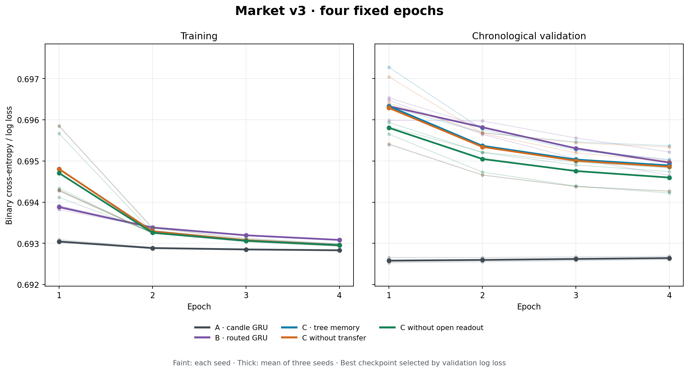
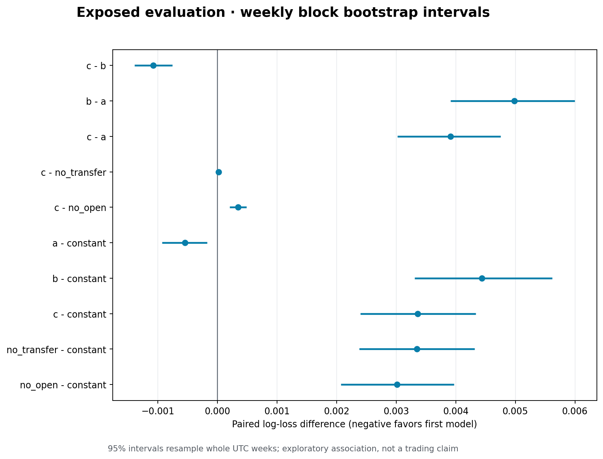

# M1 streaming research v3 — complete report

Repository: https://github.com/Flyingzaptop/xauusd
Branch: `crossing-memory-market-v3`.
Frozen **training code and pushed pretraining protocol**: `2c4da15e33bcd2c8527fae68230f325bc953499f`.
The final published result SHA is supplied in the GitHub review and delivery message.

**January–August 2026 is already exposed. Every evaluation result below is exploratory reuse, not new independent confirmation.** No instrument beyond XAUUSD M1, no MBO and no depth was added. V1/v2 source/results remain preserved.

## Does representation help, and does learned memory add value?

B minus A log loss: +0.0049854, paired weekly 95% interval [+0.0039127, +0.0059976] — higher loss on this exposed period; interval excludes zero. This is the effect of adding the complete causal router representation under the approximate parameter match.

Primary C minus B log loss: -0.0010762, paired weekly 95% interval [-0.0013898, -0.0007555] — lower loss on this exposed period; interval excludes zero. B already receives every metadata/flag input available to C; C adds the trained tree memory. This isolates added memory more closely than giving C private discrete routing signals. These are conditional comparisons for this fixed dataset and budget, not broad architectural or trading claims.

The practical conclusion is negative for adding this construction to the raw-M1 GRU: B and C both lose to A and to the constant control. C partially recovers B's deterioration, but the C-B sign is favorable on seeds7/43 and unfavorable on seed19. The weekly interval averages the three fixed runs and does **not** establish robustness to new initializations. Neither interscale transfer nor open readout adds a positive average contribution in the reported ablations; their removal slightly improves mean log loss. The transfer difference is especially small compared with between-seed variability. Therefore these data do not establish market value for the intended memory mechanism, despite the relative C-over-B mean improvement.

## Actual data and completed computation

- Train: 2024-01-01 through 2025-06-30, **522437 observed candles, 491102 valid labels**, 462 contiguous segments.
- Validation: July–December 2025, **177888 observed candles, 167691 valid labels**.
- Exposed evaluation: January–August 2026, **234102 observed candles, 221343 valid labels**.
- **15 complete fits**, five trainable variants × seeds 7/19/43, **four full epochs each**, 294 updates per epoch, **1176 updates per fit and 17640 total**. No window subsampling or replacement of the full run by a smoke check.
- Across fits: **29466120 supervised label visits and 31346220 training observation visits**. The unique label population is roughly 120 times v1's 4096 examples. The physical source file still has 3505124 rows; unused years are not claimed as training data.
- Actual launcher wall time: 29.8 minutes with 5 one-thread worker processes. Sum of fit elapsed times, including validation and contention: 2.37 hours. Preflight aggregate estimate with allowance: 3.13 hours; it is not a wall-clock deadline. Data preparation and final evaluation are outside fit timings.

Forecasts occur after a candle closes. Source metadata says its timestamp is UTC candle-open time. Target is the sign of close(t+10)-close(t); zero maps to not-up. No return regression or trading execution objective was used. Constant probability 0.5091244 is the valid train-label up frequency only.

## Shared long-history protocol

Every model consumes the same entire contiguous segment. A real timestamp gap or split boundary resets both router and neural state; no synthetic observations bridge overnight/weekend closures or missing bars. The first 64 observations after a reset are common warmup, and the last ten labels before a gap/split are excluded. All input rows still advance state. Models never secretly restart every 64 minutes.

Whole segments are assigned to sixteen independent lanes. TBPTT blocks are 128 observations per lane; their hidden states are **detached, not zeroed**, between blocks. Numerical state can retain older history while the current gradient graph is limited to one block. Train segment median/maximum lengths are 1319/1380 observations. No state crosses unrelated lanes, gaps, split boundaries or epochs. Validation/evaluation replay fresh split streams with the chosen weights.

Thresholds are train-median absolute log-close change × [8,4,2], fixed throughout events. Four OHLC features use train-only standardization and clipping at 10. Router signed progress/latest move receive signed-log transforms, maximum excursion log1p, then train-only normalization and clipping at 8. Direction, duration and retreat metadata are handled as specified in the protocol. Only 45/12538488 train metadata values and 741/2089748 feature values hit clipping. No evaluated labels choose these transforms.

Before fitting, the speed/stability report checked 16384 uninterrupted synthetic ticks and 16384 real train input rows (17 prescribed resets) with independent dummy targets and fixed weights, not market-label training. States and gradients remained finite. Full-vs-chunk, reset, causality and prediction-index tests are included in the **60-test suite**. Numeric boundedness does not prove that learned state effectively remembers every old observation; this run evaluates a state-carrying architecture, not an unlimited gradient horizon.

## Model comparison and research results

A has OHLC only. B also has all 24 continuous router metadata channels and 16 discrete channels (birth/closure/activity masks and observer one-hot). C gets the same inputs plus learned TreeCrossingMemory output. C ablations remove learned child-content transfer or learned open-state readout; ordinary metadata and the downstream GRU remain present. A/B/C have 8773/8541/8657 nominal parameters; the difference is within 1.4%. Disabled ablation paths retain nominal tensors.

All use Adam0.001, norm clipping1.0, the same four-epoch/update/data schedule and no hyperparameter search. Lowest validation log-loss epoch selects the checkpoint. All fifteen fits completed before evaluation was scored. No architecture, learning budget or preprocessing changed after evaluation results. Training curves represent online pre-update loss on the chronological stream; they are not a final-model replay of train data.

Means across seeds; ± is sample SD across seeds, not a confidence interval. Time is fit seconds per seed including validation and shared CPU contention. Lower log loss/Brier/ECE is better.

| Model | Exposed log loss mean ± SD | AUC | Brier | ECE | Parameters | Fit seconds/seed |
|---|---:|---:|---:|---:|---:|---:|
| constant | 0.6933303 ± 0.0000000 | 0.50000 | 0.2500915 | 0.00958 | 0 | 0.0 |
| a | 0.6927849 ± 0.0000483 | 0.51986 | 0.2498188 | 0.01162 | 8773 | 98.5 |
| b | 0.6977702 ± 0.0005318 | 0.51290 | 0.2522780 | 0.04350 | 8541 | 116.6 |
| c | 0.6966940 ± 0.0010298 | 0.51079 | 0.2517543 | 0.03738 | 8657 | 871.8 |
| no_transfer | 0.6966756 ± 0.0010054 | 0.51073 | 0.2517454 | 0.03733 | 8657 | 869.1 |
| no_open | 0.6963472 ± 0.0006695 | 0.51198 | 0.2515830 | 0.03683 | 8657 | 893.8 |

Every seed in fixed order 7/19/43:

| Model | Exposed log loss per seed | Selected epochs | Selected validation log loss |
|---|---|---|---|
| a | 0.6928213 / 0.6928031 / 0.6927301 | 1 / 1 / 2 | 0.6925297 / 0.6925552 / 0.6926548 |
| b | 0.6976744 / 0.6972928 / 0.6983435 | 4 / 4 / 4 | 0.6950118 / 0.6946518 / 0.6952189 |
| c | 0.6968988 / 0.6976061 / 0.6955772 | 4 / 4 / 4 | 0.6950350 / 0.6953696 / 0.6942717 |
| no_transfer | 0.6968644 / 0.6975733 / 0.6955891 | 4 / 4 / 4 | 0.6949879 / 0.6953355 / 0.6942613 |
| no_open | 0.6963796 / 0.6970000 / 0.6956620 | 4 / 4 / 4 | 0.6947411 / 0.6948294 / 0.6942202 |

## Paired temporal uncertainty and periods

Each interval resamples 2000 sets of whole UTC calendar weeks, retaining all within-week dependent minute targets. Paired per-observation loss differences are averaged across the three seeds before the weekly resampling. Negative favors the left model. Individual minutes are never independently bootstrapped. These intervals condition on the selected runs and exposed period; they do not cover every source of training/regime uncertainty or certify independent confirmation. Secondary contrasts are descriptive; no multiplicity-adjusted discovery claim is made.

| Contrast | Mean loss difference | Weekly 95% interval | Interpretation |
|---|---:|---|---|
| c - b | -0.0010762 | [-0.0013898, -0.0007555] | lower loss on this exposed period; interval excludes zero |
| b - a | +0.0049854 | [+0.0039127, +0.0059976] | higher loss on this exposed period; interval excludes zero |
| c - a | +0.0039092 | [+0.0030228, +0.0047506] | higher loss on this exposed period; interval excludes zero |
| c - no_transfer | +0.0000184 | [+0.0000061, +0.0000309] | higher loss on this exposed period; interval excludes zero |
| c - no_open | +0.0003468 | [+0.0002046, +0.0004876] | higher loss on this exposed period; interval excludes zero |
| a - constant | -0.0005454 | [-0.0009270, -0.0001734] | lower loss on this exposed period; interval excludes zero |
| b - constant | +0.0044399 | [+0.0033074, +0.0056197] | higher loss on this exposed period; interval excludes zero |
| c - constant | +0.0033637 | [+0.0023994, +0.0043376] | higher loss on this exposed period; interval excludes zero |
| no_transfer - constant | +0.0033453 | [+0.0023785, +0.0043174] | higher loss on this exposed period; interval excludes zero |
| no_open - constant | +0.0030169 | [+0.0020711, +0.0039712] | higher loss on this exposed period; interval excludes zero |

`evaluation.json` contains every model/seed/month, calibration-bin counts/predicted/observed frequencies, and per-seed contrast values. `metrics.csv` exports the overall and monthly metrics. Learning curves and comparison figures are under `plots/`; raw per-update and per-epoch data remain in all fifteen `fit-*.json` reports. No negative seed or unfavorable period is removed.





An independent result verifier reproduced all 144 metric rows, all ten paired weekly contrasts and their intervals directly from the 221343 saved prediction rows. It checked the full training budget and source/config/cache/selected-checkpoint hashes, and confirmed that 17 v1 plus 54 v2 local artifacts and protected files are unchanged. See `verification.json` and `scripts/verify_market_v3.py`.

## Limitations and preservation

This tests roughly matched parameter counts, not an exhaustive architecture/optimizer search. Four full passes are a substantial predeclared run, not a convergence guarantee. State persists over valid sessions, but real gaps terminate history and TBPTT limits gradient credit assignment. Clipped normalized router features alter what the neural model sees but do not change causal event ownership.

The synthetic v2 mechanism findings are not market evidence. An unchanged or worse market result here must remain published. This exposed evaluation cannot justify a fresh confirmatory claim, and any fitted change after its inspection requires another explicitly labelled research iteration. No spread, fees, sizing or execution was tested; no profitability conclusion follows.

V1 and v2 code/results are preserved. Raw market data, caches, predictions and weights remain local and excluded from Git. Data SHA-256: `a9dd281e0100047d56732540168af6e971ef23d858043e3e64991849a2fa6539`. Configuration, executed source and cache hashes are in each fit and the evaluation report; selected checkpoint hashes were verified before scoring.

## Reproduction

See `docs/market-v3-reproduction.md`, `docs/market-v3-protocol.md`, `docs/market-v3-budget.md` and the three preflight JSON reports. Run the frozen training commit for the recorded source identity; postprocessing lives in the final result commit.

```powershell
python scripts/prepare_market_v3.py
python -m pytest -q
python scripts/launch_market_v3.py --workers 5
python scripts/run_market_v3.py --phase evaluate
python scripts/plot_market_v3.py
python scripts/report_market_v3.py
python scripts/verify_market_v3.py
```

Local artifacts are in `artifacts/market-v3/`; their manifest lists sizes and SHA-256 values. Cache preparation requires the owner's exact M1 file. No further research iteration or new instrument is included in this report.
