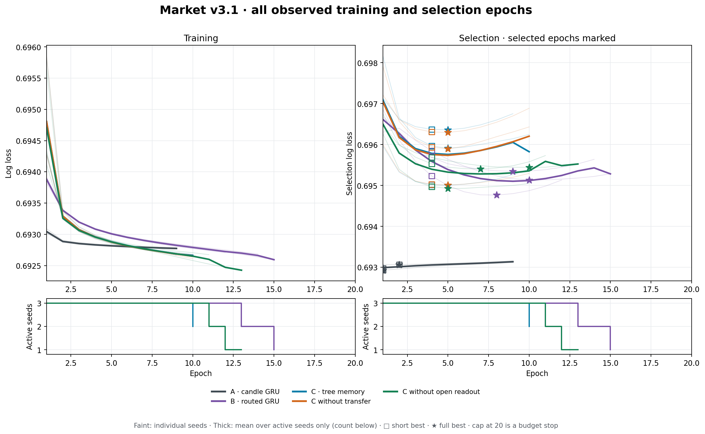
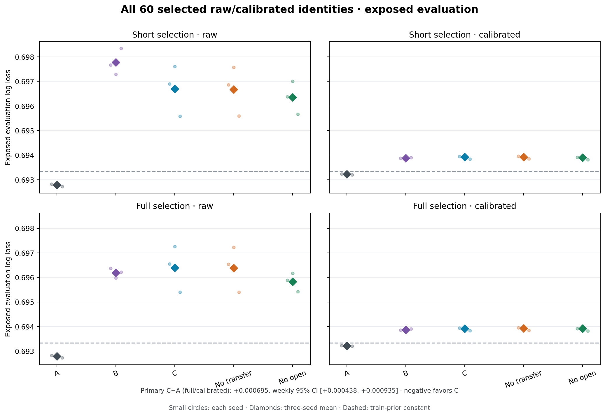

# V3.1 — training adequacy and held-apart calibration

Repository: https://github.com/Flyingzaptop/xauusd
Branch: `crossing-memory-market-v3-1`
Preregistered protocol commit: `fd2485e9b08e1db7da2bb885565f0d8d206d44e3`.
Frozen executable training/calibration/evaluation code: `8c45bbf0cafc8397384dde87bd8c84aceedb7d62`.
The final published result SHA is supplied in the review and delivery message.

**January–August 2026 is exposed exploratory evaluation. This is not independent confirmation.** V3's architecture, negative results, data sources and code remain preserved. No MBO, depth, extra instrument or new neural block was added.

## Primary conclusion: C versus A

The primary full calibrated C loses to full calibrated A in mean log loss. This iteration therefore ends with a negative conclusion and no automatic expansion of training or search.

Primary full/calibrated C − A log loss: **+0.0006946**, paired weekly 95% interval **[+0.0004376, +0.0009348]**. Per-seed differences in order7/19/43: +0.0007084, +0.0007395, +0.0006359. An improvement only against B is not the acceptance criterion. The weekly interval conditions on these three fitted seeds, not the full distribution of optimizer initializations or future regimes.

The two interventions answer different questions. Extended training reduces raw C loss by about0.000296, but after calibration the full-minus-short difference is only -0.00000235 (weekly95% interval [-0.00000949,+0.00000511]). Calibration improves full C by about0.002481, yet C still loses to calibrated A on every seed. Calibration actually worsens A on exposed evaluation by about0.000438; raw A is the strongest of these fixed variants. We report that adverse calibration effect rather than selecting a favorable postprocessing outcome.

Full calibrated C is only about0.00000609 better than its no-transfer ablation and0.00000375 better than no-open. Transfer's small conditional interval is negative, but its sign reverses on seed19; the open-readout interval contains zero. Neither effect explains away the much larger0.000695 C-A gap. These are secondary descriptive contrasts, not multiplicity-adjusted discoveries or proof of a generally useless mechanism.

Mean log loss across all three seeds, with every preselected variant shown:

| Model | Short raw | Short calibrated | Full raw | Full calibrated | Full AUC (raw=calibrated) |
|---|---:|---:|---:|---:|---:|
| a | 0.6927849 | 0.6932224 | 0.6927849 | 0.6932224 | 0.51986 |
| b | 0.6977702 | 0.6938788 | 0.6961936 | 0.6938696 | 0.51310 |
| c | 0.6966940 | 0.6939194 | 0.6963985 | 0.6939170 | 0.51088 |
| no_transfer | 0.6966756 | 0.6939245 | 0.6963831 | 0.6939231 | 0.51083 |
| no_open | 0.6963472 | 0.6938986 | 0.6958245 | 0.6939208 | 0.51206 |

Train-frequency constant control log loss: 0.6933303, AUC 0.50000, Brier 0.2500915. The constant is not another selected checkpoint.

## Actual completed budget and split separation

Fifteen from-scratch fits completed **161 full epochs, 47334 Adam updates**, and **79067422 supervised label visits**. Each full epoch used491102 valid train labels from522437 observed M1 candles. Initial parameters, architecture, Adam0.001, gradient clipping1.0, raw features, train normalization, thresholds, state resets,16 lanes and TBPTT128 were unchanged from v3. State is detached across blocks, not reset. All fits began at seeds7/19/43; selected v3 weights were not used to initialize them.

Train:2024-01-01 through June2025. Selection:July–September2025,85536 valid labels from90583 rows. Calibration:October–December2025,82081 labels from87305 rows. Exposed evaluation:January–August2026,221343 labels from234102 rows. The new October boundary resets state, applies64 warmup observations, and purges the preceding ten targets. Train/evaluation caches are byte-identical to v3. Calibration labels never select neural weights or stopping time; evaluation labels are loaded only after the complete fit matrix and all30 calibrator identities are frozen.

Actual sum of fit elapsed times: 6.70 worker-hours. Fits may overlap in at most nine single-thread processes, so this is not wall time or an isolated speed benchmark. Calibration phase wall time: 3.01 minutes; evaluation phase wall time: 7.03 minutes. See execution.json for launcher wall time and whether recovery was used.

## Did training reach a plateau?

The exact minimum selection loss chooses weights; the1e-5 threshold controls a separate patience reference. Patience starts after epoch4 and triggers after five nonimproving epochs; earliest stop9, maximum20. Short-best is the exact minimum among the first four epochs, full-best the exact minimum across the completed run. The short v3.1 choice uses the new three-month selection split and is not interchangeable with v3's original six-month checkpoint choice.

Budget-capped runs: **none**. A budget cap does not establish convergence. In capped runs the patience criterion was not reached, so a stopping plateau has not been demonstrated; recent improvements and exact best epochs are shown below. A patience stop is only an operational selection-loss criterion, not proof that optimization reached a global optimum. No extra epochs were added after either outcome.

Last-five change is last selection loss minus the first of the final five losses; negative means recent endpoint improvement. Curves contain every epoch and every batch, not only best checkpoints.

| Model | Seed | Epochs | Stop reason | Short epoch | Full epoch | Last significant improvement after4 | Last-five loss change |
|---|---:|---:|---|---:|---:|---:|---:|
| a | 7 | 9 | patience | 1 | 1 | none after 4 | +0.0000729 |
| a | 19 | 9 | patience | 1 | 1 | none after 4 | +0.0000600 |
| a | 43 | 9 | patience | 2 | 2 | none after 4 | +0.0000605 |
| b | 7 | 14 | patience | 4 | 9 | 9 | +0.0002855 |
| b | 19 | 12 | patience | 4 | 8 | 7 | +0.0003677 |
| b | 43 | 15 | patience | 4 | 10 | 10 | +0.0001469 |
| c | 7 | 10 | patience | 4 | 5 | 5 | +0.0003092 |
| c | 19 | 9 | patience | 4 | 5 | none after 4 | +0.0003916 |
| c | 43 | 10 | patience | 4 | 5 | 5 | +0.0003728 |
| no_transfer | 7 | 10 | patience | 4 | 5 | 5 | +0.0004741 |
| no_transfer | 19 | 10 | patience | 4 | 5 | 5 | +0.0005481 |
| no_transfer | 43 | 10 | patience | 4 | 5 | 5 | +0.0002626 |
| no_open | 7 | 11 | patience | 4 | 7 | 6 | +0.0003229 |
| no_open | 19 | 13 | patience | 4 | 10 | 8 | +0.0000799 |
| no_open | 43 | 10 | patience | 4 | 5 | 5 | +0.0001190 |

## Fixed positive-affine calibration

Every selected checkpoint uses exactly `sigmoid(a*z+b)`, a>=1e-6, unregularized mean log loss, fixed L-BFGS-B settings and starting point(1,0). Only the calibration quarter fits a/b. Solver and projected-gradient diagnostics are preserved. Same-weight short/full identities may share inference and fitted coefficients, but both are reported. Recovery last.pt is not an evaluation candidate.

All30 calibrator identities were saved and hashed before evaluation. Coefficient freeze: `068fc08959775f56c36fd89521d1207533f7295d1f7efdc469f343076a3442a9`. A positive slope preserves ordering. AUC is computed on original raw logits in both variants to avoid finite-precision saturation ties; **no AUC improvement is attributed to calibration**. Longer neural training can change AUC because it changes weights, unlike the affine postprocessing. Lower-bound slopes are explicitly flagged as near-constant probability forecasts.

The freeze was also [published to the coordinator before evaluation](https://github.com/Flyingzaptop/xauusd/issues/1#issuecomment-5907365625). Three A short/full pairs have identical weights, so27 unique calibrator fits supply30 reported identities. Every solver reported convergence; no slope reached the lower bound.

| Model | Seed | Checkpoint | Epoch | a | b | Solver status | Lower-bound slope |
|---|---:|---|---:|---:|---:|---|---|
| a | 7 | short_best | 1 | 0.7067936 | 0.044893372 | optimizer_converged | False |
| a | 7 | full_best | 1 | 0.7067936 | 0.044893372 | optimizer_converged | False |
| a | 19 | short_best | 1 | 0.70591525 | 0.045158456 | optimizer_converged | False |
| a | 19 | full_best | 1 | 0.70591525 | 0.045158456 | optimizer_converged | False |
| a | 43 | short_best | 2 | 0.66646547 | 0.049907306 | optimizer_converged | False |
| a | 43 | full_best | 2 | 0.66646547 | 0.049907306 | optimizer_converged | False |
| b | 7 | short_best | 4 | 0.21618918 | 0.051968083 | optimizer_converged | False |
| b | 7 | full_best | 9 | 0.2734595 | 0.051271481 | optimizer_converged | False |
| b | 19 | short_best | 4 | 0.25209114 | 0.049304521 | optimizer_converged | False |
| b | 19 | full_best | 8 | 0.3221721 | 0.047931659 | optimizer_converged | False |
| b | 43 | short_best | 4 | 0.21540215 | 0.050770944 | optimizer_converged | False |
| b | 43 | full_best | 10 | 0.28725711 | 0.053408594 | optimizer_converged | False |
| c | 7 | short_best | 4 | 0.22702128 | 0.055131433 | optimizer_converged | False |
| c | 7 | full_best | 5 | 0.23632067 | 0.056183097 | optimizer_converged | False |
| c | 19 | short_best | 4 | 0.19148639 | 0.057409913 | optimizer_converged | False |
| c | 19 | full_best | 5 | 0.19836248 | 0.058135084 | optimizer_converged | False |
| c | 43 | short_best | 4 | 0.24624045 | 0.055091037 | optimizer_converged | False |
| c | 43 | full_best | 5 | 0.24890864 | 0.055870952 | optimizer_converged | False |
| no_transfer | 7 | short_best | 4 | 0.23505711 | 0.054525768 | optimizer_converged | False |
| no_transfer | 7 | full_best | 5 | 0.24387667 | 0.05564228 | optimizer_converged | False |
| no_transfer | 19 | short_best | 4 | 0.18804651 | 0.05776188 | optimizer_converged | False |
| no_transfer | 19 | full_best | 5 | 0.193378 | 0.058599511 | optimizer_converged | False |
| no_transfer | 43 | short_best | 4 | 0.25477285 | 0.054631925 | optimizer_converged | False |
| no_transfer | 43 | full_best | 5 | 0.26188071 | 0.055225306 | optimizer_converged | False |
| no_open | 7 | short_best | 4 | 0.23489224 | 0.055486769 | optimizer_converged | False |
| no_open | 7 | full_best | 7 | 0.25553614 | 0.057515685 | optimizer_converged | False |
| no_open | 19 | short_best | 4 | 0.22716252 | 0.056061395 | optimizer_converged | False |
| no_open | 19 | full_best | 10 | 0.34056357 | 0.054810429 | optimizer_converged | False |
| no_open | 43 | short_best | 4 | 0.27738805 | 0.051440174 | optimizer_converged | False |
| no_open | 43 | full_best | 5 | 0.29219967 | 0.051758546 | optimizer_converged | False |

## Every seed and probability metric

| Model | Seed | Checkpoint | Mode | Log loss | AUC | Brier | ECE |
|---|---:|---|---|---:|---:|---:|---:|
| a | 7 | short_best | raw | 0.6928213 | 0.51984 | 0.2498368 | 0.01201 |
| a | 7 | short_best | calibrated | 0.6932342 | 0.51984 | 0.2500435 | 0.01984 |
| a | 7 | full_best | raw | 0.6928213 | 0.51984 | 0.2498368 | 0.01201 |
| a | 7 | full_best | calibrated | 0.6932342 | 0.51984 | 0.2500435 | 0.01984 |
| a | 19 | short_best | raw | 0.6928031 | 0.51993 | 0.2498278 | 0.01219 |
| a | 19 | short_best | calibrated | 0.6932310 | 0.51993 | 0.2500420 | 0.02003 |
| a | 19 | full_best | raw | 0.6928031 | 0.51993 | 0.2498278 | 0.01219 |
| a | 19 | full_best | calibrated | 0.6932310 | 0.51993 | 0.2500420 | 0.02003 |
| a | 43 | short_best | raw | 0.6927301 | 0.51981 | 0.2497917 | 0.01066 |
| a | 43 | short_best | calibrated | 0.6932022 | 0.51981 | 0.2500277 | 0.01979 |
| a | 43 | full_best | raw | 0.6927301 | 0.51981 | 0.2497917 | 0.01066 |
| a | 43 | full_best | calibrated | 0.6932022 | 0.51981 | 0.2500277 | 0.01979 |
| b | 7 | short_best | raw | 0.6976744 | 0.51320 | 0.2522334 | 0.04411 |
| b | 7 | short_best | calibrated | 0.6938692 | 0.51320 | 0.2503607 | 0.02183 |
| b | 7 | full_best | raw | 0.6963750 | 0.51300 | 0.2515946 | 0.03625 |
| b | 7 | full_best | calibrated | 0.6938607 | 0.51300 | 0.2503563 | 0.02239 |
| b | 19 | short_best | raw | 0.6972928 | 0.51344 | 0.2520443 | 0.04106 |
| b | 19 | short_best | calibrated | 0.6938711 | 0.51344 | 0.2503615 | 0.02240 |
| b | 19 | full_best | raw | 0.6959839 | 0.51419 | 0.2514015 | 0.03413 |
| b | 19 | full_best | calibrated | 0.6938447 | 0.51419 | 0.2503483 | 0.02255 |
| b | 43 | short_best | raw | 0.6983435 | 0.51206 | 0.2525564 | 0.04535 |
| b | 43 | short_best | calibrated | 0.6938959 | 0.51206 | 0.2503739 | 0.02212 |
| b | 43 | full_best | raw | 0.6962220 | 0.51211 | 0.2515164 | 0.03422 |
| b | 43 | full_best | calibrated | 0.6939036 | 0.51211 | 0.2503776 | 0.02244 |
| c | 7 | short_best | raw | 0.6968988 | 0.51038 | 0.2518570 | 0.03859 |
| c | 7 | short_best | calibrated | 0.6939455 | 0.51038 | 0.2503987 | 0.02203 |
| c | 7 | full_best | raw | 0.6965451 | 0.51053 | 0.2516828 | 0.03684 |
| c | 7 | full_best | calibrated | 0.6939426 | 0.51053 | 0.2503972 | 0.02196 |
| c | 19 | short_best | raw | 0.6976061 | 0.50836 | 0.2522004 | 0.03989 |
| c | 19 | short_best | calibrated | 0.6939747 | 0.50836 | 0.2504132 | 0.02146 |
| c | 19 | full_best | raw | 0.6972579 | 0.50846 | 0.2520303 | 0.03794 |
| c | 19 | full_best | calibrated | 0.6939704 | 0.50846 | 0.2504111 | 0.02150 |
| c | 43 | short_best | raw | 0.6955772 | 0.51363 | 0.2512056 | 0.03368 |
| c | 43 | short_best | calibrated | 0.6938380 | 0.51363 | 0.2503451 | 0.02171 |
| c | 43 | full_best | raw | 0.6953924 | 0.51365 | 0.2511142 | 0.03242 |
| c | 43 | full_best | calibrated | 0.6938381 | 0.51365 | 0.2503452 | 0.02165 |
| no_transfer | 7 | short_best | raw | 0.6968644 | 0.51031 | 0.2518402 | 0.03833 |
| no_transfer | 7 | short_best | calibrated | 0.6939548 | 0.51031 | 0.2504033 | 0.02214 |
| no_transfer | 7 | full_best | raw | 0.6965356 | 0.51041 | 0.2516782 | 0.03666 |
| no_transfer | 7 | full_best | calibrated | 0.6939549 | 0.51041 | 0.2504034 | 0.02219 |
| no_transfer | 19 | short_best | raw | 0.6975733 | 0.50845 | 0.2521846 | 0.03988 |
| no_transfer | 19 | short_best | calibrated | 0.6939716 | 0.50845 | 0.2504117 | 0.02142 |
| no_transfer | 19 | full_best | raw | 0.6972187 | 0.50863 | 0.2520112 | 0.03776 |
| no_transfer | 19 | full_best | calibrated | 0.6939654 | 0.50863 | 0.2504086 | 0.02153 |
| no_transfer | 43 | short_best | raw | 0.6955891 | 0.51343 | 0.2512114 | 0.03376 |
| no_transfer | 43 | short_best | calibrated | 0.6938472 | 0.51343 | 0.2503497 | 0.02178 |
| no_transfer | 43 | full_best | raw | 0.6953950 | 0.51346 | 0.2511153 | 0.03233 |
| no_transfer | 43 | full_best | calibrated | 0.6938490 | 0.51346 | 0.2503506 | 0.02182 |
| no_open | 7 | short_best | raw | 0.6963796 | 0.51116 | 0.2516014 | 0.03706 |
| no_open | 7 | short_best | calibrated | 0.6939112 | 0.51116 | 0.2503816 | 0.02196 |
| no_open | 7 | full_best | raw | 0.6958826 | 0.51102 | 0.2513555 | 0.03386 |
| no_open | 7 | full_best | calibrated | 0.6939120 | 0.51102 | 0.2503819 | 0.02206 |
| no_open | 19 | short_best | raw | 0.6970000 | 0.51003 | 0.2519014 | 0.03857 |
| no_open | 19 | short_best | calibrated | 0.6939701 | 0.51003 | 0.2504109 | 0.02174 |
| no_open | 19 | full_best | raw | 0.6961670 | 0.51040 | 0.2514916 | 0.03356 |
| no_open | 19 | full_best | calibrated | 0.6940276 | 0.51040 | 0.2504393 | 0.02223 |
| no_open | 43 | short_best | raw | 0.6956620 | 0.51475 | 0.2512464 | 0.03487 |
| no_open | 43 | short_best | calibrated | 0.6938146 | 0.51475 | 0.2503334 | 0.02192 |
| no_open | 43 | full_best | raw | 0.6954238 | 0.51474 | 0.2511287 | 0.03323 |
| no_open | 43 | full_best | calibrated | 0.6938228 | 0.51474 | 0.2503375 | 0.02204 |

Monthly results and every nonempty reliability bin are retained in evaluation.json
and metrics.csv. Plots show all seeds and avoid extending a stopped run's curve
as if it continued training. Low-count calibration bins remain visible with
their limited support indicated. Raw and calibrated AUC must agree for each
checkpoint/seed/month; probability calibration does not improve ranking.





## Paired weekly intervals and ablations

Whole UTC weeks are resampled2000 times with seed20260930 after averaging paired
minute losses over the three fixed model seeds. No independent-minute bootstrap
is used for overlapping ten-minute targets. Intervals below are conditional and
secondary comparisons are not multiplicity-adjusted discoveries. Negative favors
the left variant. The full60-contrast machine report also includes constant controls.

| Matched comparison | Difference | Weekly95% interval | Seed7 /19 /43 differences |
|---|---:|---|---|
| c/short_best/raw − a/short_best/raw | +0.0039092 | [+0.0029753, +0.0047813] | +0.0040775 / +0.0048030 / +0.0028471 |
| c/short_best/raw − b/short_best/raw | -0.0010762 | [-0.0014073, -0.0007551] | -0.0007757 / +0.0003133 / -0.0027662 |
| b/short_best/raw − a/short_best/raw | +0.0049854 | [+0.0039192, +0.0060244] | +0.0048531 / +0.0044897 / +0.0056134 |
| c/short_best/raw − no_transfer/short_best/raw | +0.0000184 | [+0.0000057, +0.0000313] | +0.0000344 / +0.0000328 / -0.0000119 |
| c/short_best/raw − no_open/short_best/raw | +0.0003468 | [+0.0002047, +0.0004867] | +0.0005192 / +0.0006061 / -0.0000848 |
| c/short_best/calibrated − a/short_best/calibrated | +0.0006969 | [+0.0004385, +0.0009341] | +0.0007113 / +0.0007437 / +0.0006358 |
| c/short_best/calibrated − b/short_best/calibrated | +0.0000406 | [-0.0000099, +0.0000904] | +0.0000763 / +0.0001035 / -0.0000579 |
| b/short_best/calibrated − a/short_best/calibrated | +0.0006563 | [+0.0004009, +0.0008826] | +0.0006350 / +0.0006401 / +0.0006937 |
| c/short_best/calibrated − no_transfer/short_best/calibrated | -0.0000051 | [-0.0000096, -0.0000010] | -0.0000093 / +0.0000031 / -0.0000092 |
| c/short_best/calibrated − no_open/short_best/calibrated | +0.0000207 | [-0.0000111, +0.0000518] | +0.0000343 / +0.0000046 / +0.0000233 |
| c/full_best/raw − a/full_best/raw | +0.0036136 | [+0.0027241, +0.0044502] | +0.0037238 / +0.0044548 / +0.0026623 |
| c/full_best/raw − b/full_best/raw | +0.0002049 | [-0.0000869, +0.0004858] | +0.0001701 / +0.0012740 / -0.0008296 |
| b/full_best/raw − a/full_best/raw | +0.0034088 | [+0.0026395, +0.0041810] | +0.0035537 / +0.0031808 / +0.0034919 |
| c/full_best/raw − no_transfer/full_best/raw | +0.0000154 | [+0.0000005, +0.0000307] | +0.0000095 / +0.0000392 / -0.0000025 |
| c/full_best/raw − no_open/full_best/raw | +0.0005740 | [+0.0003657, +0.0007809] | +0.0006625 / +0.0010909 / -0.0000313 |
| c/full_best/calibrated − a/full_best/calibrated | +0.0006946 | [+0.0004376, +0.0009348] | +0.0007084 / +0.0007395 / +0.0006359 |
| c/full_best/calibrated − b/full_best/calibrated | +0.0000474 | [-0.0000357, +0.0001262] | +0.0000819 / +0.0001258 / -0.0000655 |
| b/full_best/calibrated − a/full_best/calibrated | +0.0006472 | [+0.0003990, +0.0008698] | +0.0006265 / +0.0006137 / +0.0007014 |
| c/full_best/calibrated − no_transfer/full_best/calibrated | -0.0000061 | [-0.0000114, -0.0000010] | -0.0000124 / +0.0000050 / -0.0000109 |
| c/full_best/calibrated − no_open/full_best/calibrated | -0.0000037 | [-0.0000672, +0.0000556] | +0.0000306 / -0.0000572 / +0.0000153 |
| a/full_best/raw − a/short_best/raw | +0.0000000 | [+0.0000000, +0.0000000] | +0.0000000 / +0.0000000 / +0.0000000 |
| a/full_best/calibrated − a/short_best/calibrated | +0.0000000 | [+0.0000000, +0.0000000] | +0.0000000 / +0.0000000 / +0.0000000 |
| a/short_best/calibrated − a/short_best/raw | +0.0004376 | [+0.0001878, +0.0006853] | +0.0004129 / +0.0004279 / +0.0004720 |
| a/full_best/calibrated − a/full_best/raw | +0.0004376 | [+0.0001878, +0.0006853] | +0.0004129 / +0.0004279 / +0.0004720 |
| b/full_best/raw − b/short_best/raw | -0.0015766 | [-0.0019681, -0.0011964] | -0.0012995 / -0.0013089 / -0.0021214 |
| b/full_best/calibrated − b/short_best/calibrated | -0.0000091 | [-0.0000630, +0.0000478] | -0.0000085 / -0.0000265 / +0.0000077 |
| b/short_best/calibrated − b/short_best/raw | -0.0038915 | [-0.0047562, -0.0030362] | -0.0038052 / -0.0034217 / -0.0044476 |
| b/full_best/calibrated − b/full_best/raw | -0.0023240 | [-0.0029298, -0.0017329] | -0.0025143 / -0.0021392 / -0.0023185 |
| c/full_best/raw − c/short_best/raw | -0.0002955 | [-0.0003548, -0.0002325] | -0.0003537 / -0.0003482 / -0.0001848 |
| c/full_best/calibrated − c/short_best/calibrated | -0.0000023 | [-0.0000095, +0.0000051] | -0.0000029 / -0.0000042 / +0.0000001 |
| c/short_best/calibrated − c/short_best/raw | -0.0027747 | [-0.0034769, -0.0020954] | -0.0029533 / -0.0036314 / -0.0017393 |
| c/full_best/calibrated − c/full_best/raw | -0.0024815 | [-0.0031274, -0.0018381] | -0.0026025 / -0.0032875 / -0.0015544 |
| no_transfer/full_best/raw − no_transfer/short_best/raw | -0.0002925 | [-0.0003517, -0.0002306] | -0.0003288 / -0.0003546 / -0.0001942 |
| no_transfer/full_best/calibrated − no_transfer/short_best/calibrated | -0.0000014 | [-0.0000086, +0.0000061] | +0.0000001 / -0.0000061 / +0.0000018 |
| no_transfer/short_best/calibrated − no_transfer/short_best/raw | -0.0027511 | [-0.0034501, -0.0020767] | -0.0029095 / -0.0036017 / -0.0017420 |
| no_transfer/full_best/calibrated − no_transfer/full_best/raw | -0.0024600 | [-0.0031069, -0.0018194] | -0.0025806 / -0.0032533 / -0.0015460 |
| no_open/full_best/raw − no_open/short_best/raw | -0.0005227 | [-0.0006907, -0.0003312] | -0.0004969 / -0.0008329 / -0.0002383 |
| no_open/full_best/calibrated − no_open/short_best/calibrated | +0.0000221 | [-0.0000190, +0.0000662] | +0.0000008 / +0.0000575 / +0.0000081 |
| no_open/short_best/calibrated − no_open/short_best/raw | -0.0024486 | [-0.0031119, -0.0017916] | -0.0024684 / -0.0030299 / -0.0018474 |
| no_open/full_best/calibrated − no_open/full_best/raw | -0.0019037 | [-0.0024482, -0.0013667] | -0.0019707 / -0.0021394 / -0.0016010 |

Check C versus A first, then transfer/open ablations under the same checkpoint
and calibration choice. Full-minus-short comparisons address extended training;
calibrated-minus-raw comparisons address the fixed probability correction.
Do not select whichever combination happened to score best after seeing this
exposed evaluation. The mechanism's synthetic validity is not market evidence.

## Preservation and reproduction

Model and Adam state, RNG and early-stop state are saved in short-best/full-best
and the overwritten recovery checkpoint. Exact epoch-boundary resume was tested.
V3 code/results and earlier stages are retained unchanged. Raw data, caches,
optimizer states and weights stay in ignored artifacts/market-v31; their
manifest provides locations and SHA-256 hashes. The dataset hash is
`a9dd281e0100047d56732540168af6e971ef23d858043e3e64991849a2fa6539`.

Use docs/market-v31-reproduction.md and the frozen training commit for fitting;
postprocessing scripts are in the final report commit. The core commands are:

```powershell
python scripts/prepare_market_v31.py
python scripts/launch_market_v31.py --workers 9
python scripts/score_market_v31.py --phase calibrate
python scripts/score_market_v31.py --phase evaluate
python scripts/plot_market_v31.py
python scripts/report_market_v31.py
python scripts/verify_market_v31.py
```

No broader hyperparameter search or market-profit claim follows this iteration.
If a later experiment changes the fitted procedure after these outcomes, it must
be separately identified and cannot treat this evaluation as untouched.

The independent verifier reproduced the stopping decisions without importing
the training controller, checked all model/optimizer/RNG/recovery payloads,
verified first-four-epoch equality to v3, and recomputed549 metric rows and60
paired weekly intervals. It confirmed AUC invariance, the calibration-only
fit data and freeze chain, and preservation of the prior106 local artifacts.
See `verification.json` for the full machine-readable audit.
